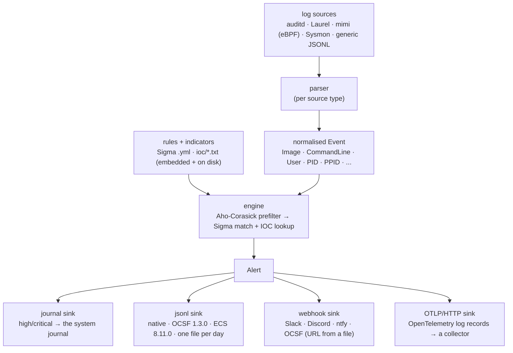

# banken

[](https://github.com/conor-sometimes/banken/actions/workflows/ci.yml)


番犬 - "watchdog". A small, host-wide EDR: it watches the machine's logs on a timer, matches them
against Sigma rules and IOC lists, and alerts. One Go binary, no agent runtime, no Python - a
poor-man's SentinelOne you can actually read.

The goal is **SentinelOne for the masses**: install it in one command, no fiddling - a sane default
ruleset, the log source auto-detected, a hardened unit and timer, enabled. Everything below is in
service of that (and of never lying about what's detected).

Deeper docs are in [`docs/`](docs/): [architecture](docs/architecture.md),
[writing rules](docs/writing-rules.md), [deployment](docs/deployment.md).

**Install or contribute:** [docs/install-and-onboarding.md](docs/install-and-onboarding.md) is the
follow-along guide: one line on NixOS, the per-distro steps and gotchas everywhere else, and the
developer happy path. Contributors: [CONTRIBUTING.md](CONTRIBUTING.md).

Not an agent thing: banken watches the *whole host*. A contained AI agent, a cron job, a logged-in
user - if it does something a rule flags, banken alerts. (The
[agent containment](https://github.com/conor-sometimes/nixos-agent-containment) is one consumer: it
adds its own tighter agent-specific rules on top.)

## What it supports

A map of what is real today. Each line is verified against the code; the sections further down give
the detail and how each claim is checked. In-progress items are marked as such, not as done.

**Sources** (a parser per source, selected with `-source type:path`):

| Source | What | Status |
| --- | --- | --- |
| **auditd** | raw Linux audit log; the multi-line SYSCALL/EXECVE/PATH/CWD/PROCTITLE records stitched into one event | implemented, live on 8 distros |
| **Laurel** | auditd rendered to JSON ([Laurel](https://github.com/threathunters-io/laurel)), one event per line | implemented |
| **mimi** | [mimi](https://github.com/conor-sometimes/mimi), banken's own eBPF sensor, as a live OCSF exec stream followed continuously | implemented, exercised across the live distro matrix (Test B) |
| **Sysmon for Linux** | Microsoft `sysmonforlinux` XML events; the field names are Windows Sysmon's, so Windows Sigma rules apply unchanged | parser + NixOS module wiring; live validation with Microsoft's binary in progress |
| **generic JSONL** | one pre-normalised event per line, the universal adapter for any external collector | implemented |
| journald, syslog / auth | systemd journal, RFC 3164/5424 auth logs | stub (interface placeholder, emits nothing yet) |

**Outputs** (pluggable sinks, any combination):

| Sink | Shapes |
| --- | --- |
| journal | high/critical to the system journal, plus a one-line login summary |
| jsonl (one file per day) | banken native, OCSF 1.3.0, or ECS 8.11.0 |
| webhook | generic, Slack, Discord, ntfy, or OCSF |
| OTLP/HTTP | OpenTelemetry log records POSTed to a collector |

**Detection:**

- The SigmaHQ Linux rule set, pinned at release `r2026-07-01` (all 210 rules load and evaluate),
  plus banken's own rules organised by ATT&CK tactic and account-scoped agent rules in `rules/agent/`.
- Sigma evaluated natively: field modifiers `contains` / `startswith` / `endswith` / `re` / `cidr` /
  `all`, plain-value equality, `*`/`?` wildcards, keyword (field-less) selections, and conditions of
  `and` / `or` / `not` / parens with `N of ...` / `all of ...`. Not yet: `base64`/`base64offset` and
  the Windows transforms (`utf16`/`wide`/`windash`), per-logsource routing (every rule is evaluated
  against every event today), Sigma correlation/aggregation rules, and null (field-absent) matches --
  a rule using any of these is reported at load with the file and reason, never silently dropped.
- IOC lists (`ioc/*.txt`): the matcher types each indicator by shape and matches filename/path, IP
  (IPv4/IPv6) and domain (exact or dot-suffix) indicators against the Image, CommandLine,
  TargetFilename and CurrentDirectory fields. Hash indicators are not yet a kind. No baseline feeds
  ship in the binary -- drop your own `ioc/*.txt` into a rules dir.
- Optional rules shipped-but-off, with an observe mode that records without paging.
- An Aho-Corasick literal prefilter makes match time independent of the rule count, fuzz-proven to
  only ever over-admit, never miss a detection.
- ATT&CK coverage is **measured** by a live Atomic Red Team range, not a self-reported number.

**Platform:** Linux hosts with systemd only (the security model is the systemd sandbox). Installed
via the NixOS module (`services.banken`) or generic systemd ([docs/deployment.md](docs/deployment.md)),
and tested live on 8 distros plus NixOS: Rocky Linux 9, AlmaLinux 10, Fedora 44, Amazon Linux 2023,
Debian 13, Ubuntu 24.04, openSUSE Leap 16, Arch.

**Standards done and checked in CI:** SigmaHQ conformance against pySigma, OCSF 1.3.0 Detection
Findings (validated by the OCSF project's own validator), ECS 8.11.0, OTLP export, and ATT&CK
Navigator layer export. Aspirational ones (YARA, STIX/TAXII, SBOM/SLSA) are listed as planned, not
supported.

**Configuration surface:** every setting is both a CLI flag and a NixOS option (the module writes the
YAML the binary reads), so nothing is reachable only one way.

- **CLI flags:** `-config`, `-rules`, `-optional`, `-observe`, `-state`, `-source type:path`
  (repeatable), `-watch`, `-follow`, `-interval`, `-journal`, `-jsonl-dir`, `-jsonl-format`
  (`banken`|`ocsf`|`ecs`), `-jsonl-retention`, `-webhook-url-file`, `-webhook-style`
  (`generic`|`slack`|`discord`|`ntfy`|`ocsf`), `-otlp-endpoint`, `-version`.
- **NixOS module (`services.banken`):** `enable`, `package`, `interval`, `sources`
  (`[{type,path}]`, type `laurel`/`auditd`/`generic`/`mimi`/`sysmon`), `extraRules`, `optionalRules`,
  `observeRules`; `mimi.{enable,streamPath}`; `sysmon.{enable,fromJournal,journalIdentifier,
  bridgePath,logPath}`; `audit.{enable,watchPaths}`; and the sinks `alerts.journal.enable`,
  `alerts.jsonl.{enable,dir,retentionDays,format}`, `alerts.webhook.{enable,urlFile,url,style}`,
  `alerts.otlp.{enable,endpoint,headers}`.
- **Run modes:** one-shot (timer-driven auditd floor, the default), `--watch` (continuous: scans the
  floor on `--interval` and follows any live sensor stream in one process), and `--follow` (one
  sensor source as a push stream, capture-to-match latency logged). A bare `banken` with no source
  configured auto-detects the host's Laurel or raw audit log.

## How it works

Logs in, alerts out - one pass, no state beyond a cursor:



The prefilter can only over-admit, never miss (a fuzz target proves it agrees with checking every
rule), so it is a speed-up with no detection cost. A systemd timer drives the pass; `--watch` self-
times instead. See [docs/architecture.md](docs/architecture.md) for the detail.

## Supported platforms

**Linux with systemd** (banken's security model is its systemd sandbox; see
[docs/deployment.md](docs/deployment.md#supported-platforms)). Each distro below is tested live by the
[distro matrix](tests/distros/README.md): its official cloud image booted under KVM, banken installed
as the docs say, benign malware look-alikes run against that distro's own kernel and auditd, and 15
objectives checked, from a clean install to exact detections, no false positives on a normal day,
valid OCSF and the sandbox. `nix run .#distro-matrix` runs it.

| Distro | Status | Last verified |
| --- | --- | --- |
| Rocky Linux 9 (RHEL 9) | all 15 objectives pass, SELinux enforcing | 2026-10-31 |
| AlmaLinux 10 (RHEL 10) | all 15 objectives pass, SELinux enforcing | 2026-10-31 |
| Fedora 44 | all 15 objectives pass, SELinux enforcing † | 2026-10-31 |
| Debian 13 | all 15 objectives pass, AppArmor active | 2026-10-31 |
| Ubuntu 24.04 LTS | all 15 objectives pass, AppArmor active | 2026-10-31 |
| openSUSE Leap 16 | all 15 objectives pass, SELinux enforcing † | 2026-10-31 |
| Arch Linux | all 15 objectives pass | 2026-10-31 |
| NixOS | module VM test passes ([`tests/vm.nix`](tests/vm.nix)) | 2026-10-31 |
| Amazon Linux 2023 | all 15 objectives pass | 2026-10-31 |

x86_64; aarch64 builds but is not yet tested.

† Fedora and openSUSE ship a stock `-a task,never` auditd rule - it tells auditd never to record
events for newly created tasks, which blinds banken to process execs. banken detects it and warns at
startup (`auditcheck`), and removing that one rule restores full detection; the matrix test does so
before scoring, so the 15 objectives pass on a correctly-configured host.

## Standards

What banken implements, and how each claim is checked. "Validated" means an independent tool
checks banken's output; "measured" means a public test suite is run against it.

| Standard | What banken does | How it is checked |
| --- | --- | --- |
| [Sigma](https://sigmahq.io) | Rule format: banken compiles Sigma rules natively, its own and SigmaHQ's | Loads all 210 of SigmaHQ's Linux rules at release `r2026-07-01` (`tools/sigmacov`); agrees with pySigma, the reference implementation, on 182 of 182 evaluations (`conformance/`) |
| [OCSF](https://schema.ocsf.io) 1.3.0 | Alerts as Detection Findings (class 2004), `host` and `osint` profiles | **Validated**: every committed finding passes the OCSF project's own validator (ocsf-toolkit) against the compiled 1.3.0 schema, in CI (`just ocsf-validate`) |
| [ECS](https://www.elastic.co/guide/en/ecs/current/index.html) 8.11.0 | Alerts as Elastic Common Schema documents (`-jsonl-format ecs`), a second output mapping for Elastic shops | Encoder unit-tested (`internal/alert/ecs_test.go`) |
| [MITRE ATT&CK](https://attack.mitre.org) | Every rule tagged with its tactic and technique; mapped into each finding's `attacks`, and exported as an ATT&CK Navigator layer | Tag mapping unit-tested; Navigator layer export (`tools/attack-layer`); the ATT&CK range below scores detection per technique |
| [OTLP](https://opentelemetry.io/docs/specs/otlp/) / OpenTelemetry | Export findings as OTLP/HTTP log records to a collector | Exporter unit-tested (`internal/alert/otlp_test.go`) |
| [Atomic Red Team](https://github.com/redcanaryco/atomic-red-team) | The live ATT&CK range: every Linux atomic of a pinned commit, run for real in a throwaway VM | **Measured**: 24 of 115 techniques detected on merit (a rule about the technique fired), 2026-11-01 (`tests/attackrange.nix`, [scoring](attackrange/README.md)) |
| Linux audit | Reads auditd's raw log and [Laurel](https://github.com/threathunters-io/laurel)'s JSON | Parser goldens and fuzzing; live on nine platforms' own auditd ([Supported platforms](#supported-platforms)) |
| systemd | Hardened unit and timer; log levels in the sd-daemon(3) form, so the journal files alerts by priority | `systemd-analyze security` on every distro in the matrix: exposure 2.1, "OK" |

`just conformance` runs the Sigma, pySigma and OCSF checks as gates against pinned versions, so a
broken claim fails the run (on NixOS: `nix develop .#conformance -c just conformance`).
`just conformance-live` adds the checks that need KVM: the distro matrix and the ATT&CK range.

Planned, not yet implemented: YARA, STIX/TAXII threat-intel feeds, an SBOM and SLSA provenance
for releases, and the OpenSSF Scorecard.

## Log sources

banken **parses the logs itself**: one parser per source, all behind one interface, each normalising
to the common event the rules match. A new source is a new parser and nothing else changes. A systemd
timer runs `banken` every interval over the auditd floor (one-shot, no daemon to babysit); a live
sensor source (mimi, Sysmon) switches it to a continuous `--watch`/`--follow` stream instead. banken
no longer *needs* Laurel: with the raw auditd parser the floor is `auditd + banken + a timer`.

| Source | What | Status |
| --- | --- | --- |
| **auditd** | raw Linux audit log - the multi-line SYSCALL/EXECVE/PATH/CWD/PROCTITLE records stitched back into one event (hex-decoded argv/proctitle, quoted and bare values) | **implemented** |
| **Laurel** | auditd → JSON ([Laurel](https://github.com/threathunters-io/laurel)), one reassembled event per line | **implemented** |
| journald | the systemd journal (`_COMM`/`_EXE`/`_CMDLINE`/`_UID`) | stubbed (interface placeholder) |
| syslog / auth | RFC 3164/5424 - `/var/log/auth.log`, `secure` (sshd / sudo / PAM logins) | stubbed (interface placeholder) |
| **generic JSONL** | one pre-normalised event per line - the universal adapter any external collector emits to (`-source generic:PATH`) | **implemented** |
| **mimi** | the [mimi](https://github.com/conor-sometimes/mimi) eBPF sensor's OCSF exec stream, followed continuously as a live push feed (`-source mimi:PATH` with `--follow`) | **implemented**; exercised across the live distro matrix (Test B) |
| **Sysmon for Linux** | Microsoft's sysmonforlinux XML events (ProcessCreate and friends) read from a syslog file or a journal bridge; the EventData field names are Windows Sysmon's, so Windows Sigma rules apply unchanged (`-source sysmon:PATH`) | **parser + NixOS module wiring** (goldens + fuzz + XXE-safe); live validation with Microsoft's binary in progress |
| network | Zeek / Suricata, for network IOCs | planned |

auditd and Laurel are wired up and tested (table + golden + fuzz, see Testing); the generic and mimi
parsers likewise. The Sysmon parser is written, fuzzed and wired into the NixOS module, but the
end-to-end run against Microsoft's real `sysmonforlinux` binary is still being built, so treat Sysmon
as validated-in-progress rather than proven. The journald and syslog parsers exist only as stubs
behind the same interface (they drain their input and emit nothing) so slotting the real logic in
later touches nothing else. **IOC kinds:** filename/path, IP and domain indicators are matched today
(against the Image, CommandLine, TargetFilename and CurrentDirectory fields of whatever source is in
use); hash indicators are not yet a kind, and a dedicated network source adds the destination fields
that make IP/domain feeds bite hardest. No baseline feeds ship -- bring your own `ioc/*.txt`.

## Rules

Portable [Sigma](https://github.com/SigmaHQ/sigma) YAML, organised so a rule's *home* says what it
is, plus plain IOC lists for bulk feeds:

    rules/
      credential-access/    persistence/    execution/
      command-and-control/  privilege-escalation/   ...   # behavioural rules, by ATT&CK tactic
      agent/                                               # account-scoped rules for autonomous AI agents
      malware/<family>/                                    # family-specific signatures (IOCs unique to a family)
      optional/                                            # opt-in policy rules, shipped but held back by default
      ioc/*.txt                                            # bulk IOC lists (filenames, IPs, domains), one per line

- **Behavioural rules** detect a *behaviour*, not a family, so they live by tactic (reading a
  credential is `credential-access/` whether AMOS, RedLine or a human did it). The SigmaHQ Linux
  set drops in by the same scheme as a noisy baseline.
- **Family signatures** are Sigma too (an IOC is just a matched value), kept under `malware/<family>/`.
- **Bulk IOC feeds** (thousands of values) go in `ioc/*.txt` as flat lists, one value per line, not
  one Sigma file each.
- **Optional rules** carry `optional: true` and ship in the binary but *off*: policy detections that
  are noisy or environment-specific - netcat use, a password cracker - which one host wants and
  another never would. An operator activates the ones their host needs by name (or `"*"` for all),
  so the shipped-on baseline stays high-signal. See [`rules/optional/`](rules/optional/).

  An optional rule has three states: **off** (default, not evaluated), **observe**
  (`observeRules` - evaluated and recorded, but marked `observed` so it never pages: measure its
  noise first), and **on** (`optionalRules` - pages normally).

```yaml
services.banken = {
  observeRules  = [ "netcat" ];            # recorded, never pages - watch it quietly
  optionalRules = [ "password_cracker" ];  # pages normally  (or: banken -optional password_cracker)
};
```

banken evaluates the field modifiers `contains` / `startswith` / `endswith` / `re` / `cidr` / `all`,
plain-value equality, `*`/`?` wildcards, keyword (bare string-list) selections, and conditions of
`and`/`or`/`not`/parens and `N of` / `all of` - with a clear load error (never a silent drop) on a
rule it can't evaluate. **Measured coverage: banken loads 100% of the SigmaHQ `rules/linux` set
(210/210 at release `r2026-07-01`)**; `just conformance` checks it, against that pinned release. "Loads" means it compiles
and evaluates; a rule that needs a field only a future source provides (e.g. a network `cidr` rule)
loads and stays inert until that source lands, rather than failing. Verdict-level conformance against
the reference engine (pySigma) is the next bar - see the roadmap.

## Alerts

Pluggable sinks, any combination:

- **journal** - high/critical to the system journal (syslog), a one-line login summary for admins.
- **jsonl** - one file per day of alerts, kept `retentionDays`, so retention is a file delete. The
  encoding is chosen per deployment (`alerts.jsonl.format` / `-jsonl-format`): banken's own native
  JSON (default), OCSF 1.3.0, or ECS 8.11.0.
- **webhook** - POST the alert to a URL, shaped for the receiver (`generic`, `slack`, `discord`,
  `ntfy`, or `ocsf`). The URL is a secret: it comes from `alerts.webhook.urlFile` (sops/agenix or a
  systemd credential), never inline in the Nix store. The service runs as root, so the webhook host
  just needs to be reachable.
- **OTLP/HTTP** - export each finding as an OpenTelemetry log record to a collector's logs endpoint
  (`alerts.otlp.endpoint` / `-otlp-endpoint http://collector:4318/v1/logs`), so any OTel-aware
  backend (Grafana, Datadog, Splunk, Elastic) ingests it with no glue. OCSF is the schema; OTLP is
  the pipe. Hand-rolled JSON, no OpenTelemetry SDK dependency.

**OCSF and ECS.** The jsonl and webhook sinks can emit alerts as [OCSF](https://schema.ocsf.io) 1.3.0
Detection Findings instead of banken's own JSON (`alerts.jsonl.format: ocsf`, `-jsonl-format ocsf`;
`alerts.webhook.style: ocsf`), so Security Lake, Splunk, Datadog or any OCSF-aware SIEM ingests them
with no per-product mapping, ATT&CK tactics and techniques included. The jsonl sink can also emit
[ECS](https://www.elastic.co/guide/en/ecs/current/index.html) 8.11.0 documents (`-jsonl-format ecs`)
for Elastic shops. Every baseline rule has a committed OCSF finding golden, and CI validates them
against the official schema with the OCSF project's own validator (`just ocsf-validate`). Design:
[docs/design/ocsf-output.md](docs/design/ocsf-output.md).

Matched alerts flow through one dispatch point, so **response actions** (kill a process, revoke a
key, isolate) slot in later without a redesign. For now: alert only.

## Performance

The rule count is not supposed to be something you worry about, so matching does **not** scan every
rule against every event. At load time every string literal across every rule
(`|contains`/`|startswith`/`|endswith`/equality) is compiled into one
[Aho-Corasick](https://en.wikipedia.org/wiki/Aho%E2%80%93Corasick_algorithm) automaton. For each
event, one pass per field finds the set of literals present anywhere in it - in time proportional to
the event length, *independent of how many rules exist* - and only the rules that could match that
set get the authoritative per-rule check (an inverted literal→rule index plus a sound upper-bound
test on the rule's condition). Regexp and negation rules that no literal can gate are kept in a small
always-evaluated set.

It is a pure prefilter in front of the unchanged per-rule matcher, never a replacement, so a rule it
skips provably could not have matched (the found-literal set is always a superset of the true
literals). That property is fuzzed: `FuzzMatcherEquivalence` asserts the compiled matcher returns the
exact same verdict as the naive "check every rule" matcher on arbitrary rules and events.

All numbers below were measured, not estimated. The full benchmark suite, its
[spec](docs/design/benchmarking.md) and the raw JSON are in [`bench/`](bench/); latency is reported
as p50 / p99 / max (never a mean, because one slow alert matters more than a fast average). The
hardware and kernel are pinned, because a number without them has no scale:

| Field | This run |
| --- | --- |
| Host | hokkaido |
| CPU | AMD Ryzen 5 3400G (4C/8T) |
| Kernel | Linux 6.18.59 |
| Go | 1.26.8 |
| Load during run | ~2.5-3.0 (a shared host, not idle) |

**Prefilter scaling** (`go test -bench`, matching one event against a synthetic tree of distinct,
regex-free rules, mean ns/op):

| Rules | Naive (every rule) | Compiled matcher | Compiled allocs/op |
| ---: | ---: | ---: | ---: |
| 100 | 79 us | 3.2 us | 6 |
| 1,000 | 932 us | 4.8 us | 6 |
| 10,000 | 11,900 us | 24.9 us | 6 |

Naive matching grows linearly with the rule count (and so do its allocations: 500 / 5,000 / 50,000);
the compiled matcher stays flat enough to carry the whole SigmaHQ Linux set, and its allocations per
event are **constant** regardless of rule count. (Parallelising across events with a goroutine pool
is a later, complementary lever - the matcher is read-only and so trivially parallel - but the
algorithm is what makes rule count cheap.)

**Detection latency, staged.** The headline number, broken into stages so a regression shows where
it landed. Measured against the *real* shipped rule tree (not the synthetic regex-free set above), on
the shared host in the table, so these are honest upper bounds - the representative quiet-box run
(lower p99/max) is pending on the pinned VM via `tests/bench.nix`. p50 / p99 / max per stage, threat
event:

| Stage | p50 | p99 | max |
| --- | ---: | ---: | ---: |
| t3 normalise (mimi JSON -> Event) | 47 us | 307 us | 5.3 ms |
| t4 prefilter + rule match | 47 us | 138 us | 696 us |
| t5 OCSF build + write | 22 us | 83 us | 4.6 ms |
| **end to end (t3..t5)** | **134 us** | **699 us** | **19 ms** |

The t4 floor is dominated by the rules the prefilter cannot gate: ~30 of the 40 baseline rules carry
a regexp, which runs on every event in the always-evaluated set. That is the real per-event cost a
deployment pays, and it is why the synthetic (regex-free) prefilter numbers above are a best case,
not the headline. t3 is JSON-heavy (mimi's nested schema is read defensively, field by field). t1
(sensor capture) and t2 (mimi -> banken transport) need the live sensor and are pending. One match
engine core sustains **~25,000 events/sec**; past that a bounded queue drops, and the harness counts
the drops explicitly (silent loss under load is the classic EDR failure).

**Footprint and startup.** Static stripped binary **7.0 MiB** (7,352,482 bytes). It links **one**
third-party package into the production binary (`gopkg.in/yaml.v3`; 3 transitive modules, ~321 KiB of
third-party source under audit - `rapid` is test-only). Cold start to the first finding on disk:
**p50 12 ms** (12/12 runs fired). Resident memory with the baseline ruleset loaded: **~14 MiB**
(short idle sample; the 24h idle CPU+RSS soak is pending - commercial agents sit at hundreds of MB).
Compiling the rule tree into the matcher costs ~1.3 ms at 40 rules, ~31 ms at 2,000, ~157 ms at
10,000 (p50), at roughly 4.5 KiB of matcher memory per rule.

End-to-end latency in the one-shot deployment model is the compute above plus at most one timer
interval, which `--watch` or a shorter interval shrinks; so the interval, not the matching, is the
latency knob. The pending categories (24h idle soak, resource cost under a kernel build, sensor
overhead with the probe attached, backpressure under a fork bomb, boot-to-finding after reboot,
false positives per host per day, and the auditd / Falco / Wazuh / osquery peer comparison) are all
wired in the harness and run by the matrix after the next rebuild; see [`bench/README.md`](bench/README.md).

## Security model

banken runs as root (it reads the root-owned audit log) and may one day pull rules from a remote
repo, so the rule channel must never become a way to run code as root - a detector you can turn into
a trojan is worse than no detector. The guarantee is layered:

1. **Rules are inert data, never code.** The Sigma subset has no eval path - no shell-out, no
   template or format expansion, no plugin loading, no rule-controlled file/URL/exec. A rule value is
   only ever matched as an opaque string; a regexp is Go's RE2 (linear time, no catastrophic
   backtracking, no code execution). YAML is parsed with `yaml.v3`, which has none of the
   object-instantiation gadgets that make `yaml.load`-style parsers dangerous. So even a
   fully attacker-authored rule can at worst produce wrong or missing *detections* - never execution.
   `TestRuleValuesAreInertData` locks this: shell substitutions, format verbs, templates, globs and
   path-traversal strings all stay literal.
2. **Logs are inert data too - the log4j lesson.** The other untrusted channel is the log itself:
   banken parses attacker-influenced bytes (an attacker can write to the audit stream through what
   they run). Parsing never interprets log content - no exec or shell-out, no format-string
   injection (every format string is a literal; log values are only ever `%q`/`%s` arguments), no
   file opened or URL fetched from a field, no template or `${...}` lookup expansion (the thing that
   made log4j a remote-code-execution bug), and the XML source refuses external entities and
   entity-expansion bombs (`TestSysmonNoXXE`; Go's `encoding/xml` resolves no external or DTD
   entities). A rule regex is RE2, so even a hostile regex matched against a crafted event cannot
   catastrophically backtrack (`TestRuleRegexCannotReDoS`, proven against the textbook evil
   patterns). Every parser is fuzzed to tens of millions of executions with zero crashes, and the
   "never fail the batch on content" contract means a malformed or adversarial line is skipped, not
   a way to blind the detector.
3. **Memory-safe, no kernel component.** banken is pure Go - no `unsafe`, no cgo, no C anywhere - so
   whole bug classes that plague EDRs are structurally impossible: no buffer overflow, no
   use-after-free, no out-of-bounds read of the untrusted bytes it parses. It is one static binary
   with no kernel module and no driver, so, unlike the agents it takes after, it **cannot panic your
   kernel or blue-screen the host** - the worst a banken bug does is a missed or wrong detection in
   userspace, caught by the panic guards, never a downed machine. CodeQL's data-flow analysis runs on
   every push on top of gosec and staticcheck.
4. **Response actions are operator policy, never rule-embedded.** A rule only emits a tag; the local
   operator config maps tags to actions (kill, quarantine). A remote rule can never carry its own
   "kill this / delete that."
5. **Trusted path (planned).** As root, banken should distrust rules from a directory writable by
   anyone but its owner (the classic local-unprivileged-user-edits-the-rule escalation) and flag it,
   with an opt-in strict mode to refuse. *Not yet implemented* - today banken only loads from the
   paths it is given; make the rules dir root-owned and `0755` yourself.
6. **The fetch is deprivileged and can't run code (planned).** When remote rule sync exists it will
   be a separate command (never the scan), neutering git's code-execution surfaces (hooks, filter
   drivers, fsmonitor) or using a plain tarball, and running as a dedicated low-privilege user.
   *There is no fetch today* - rules are local only, so this surface does not exist yet.
7. **Signed bundles (v2).** Remote rule/config bundles are signature-verified against a locally
   pinned public key with a monotonic version, so a compromised transport or repo host cannot push a
   rogue rule set in the first place.

The scan itself is one-shot and has no inbound or rule-fetch network surface by design; the only
outbound connection is the optional webhook POST from the scan process.

## Use (NixOS)

NixOS is supported first-class: the module, the package and the end-to-end VM test live in this
repo. Add the flake and enable it:

```nix
# flake.nix
inputs.banken.url = "github:conor-sometimes/banken";
# your nixosConfiguration's modules
modules = [ banken.nixosModules.default ];
```

```nix
services.banken.enable = true;   # that's the whole setup
```

`enable` turns on auditd with the rules banken reads (every execve, plus watches on
`/etc/shadow` and `/etc/gshadow`), a hardened oneshot unit, and a timer that runs a scan every
two minutes, alerting high and critical hits to the journal. Everything else is optional:

```nix
services.banken = {
  enable = true;
  interval = "30s";
  extraRules = [ ./my-rules ];                        # Sigma .yml and ioc/ lists, on top of the baseline
  alerts.jsonl = { enable = true; format = "ocsf"; };  # /var/log/banken, one OCSF finding per line
  alerts.webhook = { enable = true; urlFile = "/run/secrets/banken-webhook"; style = "slack"; };
};
```

Without flakes, import `module.nix` from a pinned checkout (see `default.nix`); the package alone is
`pkgs.callPackage ./package.nix { }`. The module is tested by `tests/vm.nix` (`nix flake check`):
a VM runs every emulation in `tests/emulations` against real auditd and asserts exactly the expected
rules fire, as OCSF findings.

## Testing

Heavily tested - a root daemon that parses untrusted log bytes and ingests rules has to be, so the
bar is "a malformed input or a hostile rule can degrade a detection, never crash the detector."

**Dev environment.** The shared dev toolbox is [workbench](https://github.com/conor-sometimes/workbench)
(it pins the same toolchain for the whole banken family, banken and mimi alike):

```sh
nix run github:conor-sometimes/workbench#banken -- -c 'just default'   # the pinned toolchain, no install
```

Or `nix develop` on this repo gives the full toolchain `just` drives (Go, gofumpt, golangci-lint,
gosec, govulncheck, staticcheck, delve, ...) with nothing to install - then `just` lists the targets
and `just default` runs the whole gate. `nix develop .#conformance` adds the standards-gate tools
(uv + Nix's Pythons); off Nix, install the tools `just` names.

- `go test ./...` - table-driven cases for every parser, the rule compiler and the matcher, plus the
  `tests/fixtures/*.json` events (`NAME.expect-<rule>.json` must fire that rule; `*.expect-none.json`
  must fire nothing), golden-file parser output, and `pgregory.net/rapid` property sweeps.
- **Never-die contracts, as tests.** `TestCursorAlwaysRecoverable` (a missing/empty/corrupt state
  file always recovers to a fresh cursor), the engine's per-event and per-source panic guards (one
  pathological record can't take down a scan), and `TestRuleValuesAreInertData` (a rule value is
  matched as opaque text - shell substitutions, format verbs, templates, globs and path-traversal
  strings never expand or execute, so a remote rule can't become root code execution).
- **Go fuzzing** (`go test -fuzz`) - the whole untrusted surface:
  - `FuzzSigmaParse` - the rule **compiler**: arbitrary YAML must compile to a clean error or a usable
    rule, never a panic (a crash while loading rules is a crash of the detector).
  - `FuzzMatcherEquivalence` - the compiled Aho-Corasick prefilter must return the **exact same
    verdict** as the naive check-every-rule matcher, on arbitrary rules and events. A divergence would
    be a silently skipped detection.
  - `FuzzEnginePipeline` - the full read → parse → normalise → match path on raw bytes, with no
    recover guard, so any latent panic surfaces.
  - `FuzzParseAuditd`, `FuzzParseLaurel`, `FuzzParseStubs`, `FuzzMatch`, `FuzzIOC` - each parser and
    matcher against random and malformed input.

  A 30-45s smoke of each target runs in CI; a longer campaign (3 min per target) reached
  **~73.6 million executions across the parser targets, zero crashes, zero equivalence
  divergences**. The per-target breakdown below is from the shorter smoke.

  | Target | Execs | Target | Execs |
  | --- | ---: | --- | ---: |
  | `FuzzEnginePipeline` | 5.75M | `FuzzMatch` | 3.75M |
  | `FuzzParseAuditd` | 3.96M | `FuzzParseLaurel` | 2.89M |
  | `FuzzIOC` | 2.44M | `FuzzMatcherEquivalence` | 2.05M |
  | `FuzzParseStubs` | 0.16M | `FuzzSigmaParse` | 0.14M |

- `tests/emulations/<family>.sh` - benign look-alikes of real malware (dummy data, unroutable "C2",
  cleaned up; see `tests/emulations/README.md`). The NixOS VM test (`tests/vm.nix`) runs each as an
  ordinary user against real auditd and asserts the rules that fire are *exactly* the family's
  expected set - a miss and a false positive both fail. Its first run found two bugs no fixture
  could: every exec reported its own binary as a target (so banken's own scan tripped
  `tamper_banken`), and NixOS's multicall coreutils hid `cat`/`rm`/`base64` behind `exe=coreutils`.
- **Performance is benchmarked and regression-tracked** - `just bench` / `just bench-compare`
  (`benchstat`) for the matcher and parsers, and `just bench-e2e` (`hyperfine`) for a full binary
  scan over a large synthetic log. See [Performance](#performance).
- **CI** (`.github/workflows`) runs `go test -race`, `go vet`, `staticcheck`, `golangci-lint`,
  `errcheck`, `gosec`, `govulncheck`, a short fuzz smoke and the benchmarks on every push, a
  **nightly fuzz campaign** (5 min/target, corpus cached between runs), and
  validates the OCSF goldens against the official schema (`just ocsf-validate`). The VM test needs
  KVM and runs on the project's build host (`nix flake check`).

After cloning, run `just install-hooks` once: it points `core.hooksPath` at the repo's tracked
`.githooks/`, whose `commit-msg` hook keeps AI-tool attribution out of commit messages.

## Status

Early, but past the floor. Working today: raw auditd and Laurel input, the generic JSONL adapter,
the mimi eBPF sensor as a live stream, the Sigma subset above with SigmaHQ's Linux set, IOC lists,
journal/jsonl/webhook/OTLP alerts in native/OCSF/ECS shapes, the one-shot timer and the `--watch`
/`--follow` daemon. In progress: end-to-end Sysmon-for-Linux validation against Microsoft's real
binary. Roadmap: the journald and syslog/auth parsers (stubs today), network sources, hash/network
IOCs, response actions, and a baseline tuned over a week of real activity.

## Licence

MIT (see [LICENSE](LICENSE)). Rules are plain Sigma - copy them out with `git subtree split rules/`
if you want them without the binary.
