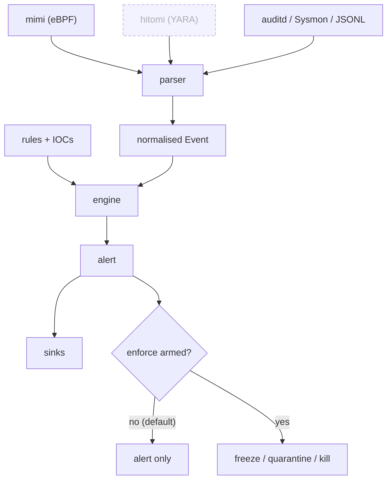

# banken

[](https://github.com/conor-sometimes/banken/actions/workflows/ci.yml)


**番犬, "watchdog".** A small, host-wide EDR for Linux.

It reads the machine's audit and eBPF stream. It matches that against Sigma rules and IOC lists. It hands your SIEM a standards finding. One static Go binary. No agent runtime, no Python, no kernel module.

A poor-man's SentinelOne you can actually read.

banken is the brain of a small sensor family. Each sensor is listener-only. Each feeds one normalised Event. banken correlates them and decides.

| | | Role | State |
| --- | --- | --- | --- |
| **banken** | 番犬 watchdog | Parse, match, decide, alert, respond | Working |
| **[mimi](https://github.com/conor-sometimes/mimi)** | 耳 ears | eBPF sensor: what a process *did* | Shipping |
| **hitomi** | 瞳 eyes | YARA sensor: what a file *is* | Building |

## Contents

- [Proof](#proof)
- [Highlights](#highlights)
- [How it works](#how-it-works)
- [Sources and outputs](#sources-and-outputs)
- [Install](#install)
- [Rules](#rules)
- [Standards](#standards)
- [Security model](#security-model)
- [Performance](#performance)
- [Testing](#testing)
- [Roadmap](#roadmap)
- [Licence](#licence)

## Proof

banken catches a live reverse shell end-to-end in under **300 ms**, off its mimi eBPF sensor:

- 267 ms in the VM switch test
- ~30 ms on real hardware

The alert comes out as a standard OCSF 1.3.0 Detection Finding, with the ATT&CK technique attached.

Boot it yourself:

```sh
nix run github:conor-sometimes/banken#demo        # auditd floor (needs only KVM)
nix run github:conor-sometimes/banken#demo-mimi    # the eBPF switch: the sub-second catch
```

Each boots a NixOS VM. It runs the repo's own benign [`revshell.sh`](tests/emulations/revshell.sh) as an unprivileged user. Then it prints:

- the OCSF finding
- the exec-to-alert latency
- the finding delivered to a mock SIEM
- an ordinary admin workload raising zero alerts
- the static-binary sandbox score

The demos reuse the real end-to-end tests. They cannot claim a detection the suite does not gate.

## Highlights

- **100% SigmaHQ Linux coverage.** All 210/210 rules of `rules/linux` (`r2026-07-01`) load and evaluate. banken agrees with pySigma on 182/182.
- **Own detections.** ~59 rules by ATT&CK tactic. 11 of them are account-scoped rules for autonomous AI agents (`rules/agent/`), a niche SigmaHQ does not cover.
- **Standards out, no glue.** OCSF 1.3.0 (CI-validated), ECS 8.11.0, or OTLP/HTTP. Any such backend ingests them with no per-product mapping.
- **Proven on real distros.** Green on 8 distros plus NixOS, on their own kernels and auditd.
- **Tiny and safe.** One static CGO-free binary, ~7 MiB, ~14 MiB RAM. No kernel module. A bug is a missed detection, never a kernel panic.
- **Rule count is free.** An Aho-Corasick prefilter makes match time independent of rule count. Fuzz-proven to over-admit, never miss.
- **Measured, not claimed.** ATT&CK coverage is scored by a live Atomic Red Team range: 24/115 techniques on merit (2026-11-01).

`just conformance` gates the Sigma, pySigma and OCSF claims against pinned versions. A broken claim fails the build.

## How it works

Sensors in, alerts out, optional response. One pass, no state beyond a cursor.



hitomi is dashed because it is in build. mimi ships today. A systemd timer drives the pass. `--watch` follows a live sensor stream instead. The engine internals and the two-process response split are in [docs/architecture.md](docs/architecture.md).

## Sources and outputs

One parser per source, all behind one interface. Each normalises to the event the rules match. Pick sources with `-source type:path`.

| Source | What | State |
| --- | --- | --- |
| **auditd** | Raw Linux audit log, multi-line records stitched into one event | Live on 8 distros |
| **Laurel** | auditd rendered to JSON ([Laurel](https://github.com/threathunters-io/laurel)) | Implemented |
| **mimi** | [mimi](https://github.com/conor-sometimes/mimi) eBPF sensor, a live OCSF exec stream | Live across the matrix |
| **Sysmon for Linux** | Microsoft `sysmonforlinux` XML; Windows Sigma rules apply unchanged | Wiring done, validating |
| **generic JSONL** | One pre-normalised event per line | Implemented |
| journald, syslog/auth | systemd journal, RFC 3164/5424 auth logs | Stub |

Outputs are pluggable sinks. Use any combination:

- **journal** - the system journal
- **jsonl** - one file per day, in native / OCSF / ECS
- **webhook** - generic, Slack, Discord, ntfy, or OCSF
- **OTLP/HTTP** - to an OpenTelemetry collector

Every alert flows through one dispatch point.

## Install

Linux with systemd only. NixOS is first-class: the module, package and VM test live here. Any other systemd distro installs the binary and unit by hand. See [docs/deployment.md](docs/deployment.md) and [docs/install-and-onboarding.md](docs/install-and-onboarding.md).

```nix
# flake.nix
inputs.banken.url = "github:conor-sometimes/banken";
# in your nixosConfiguration's modules:
modules = [ banken.nixosModules.default ];
```

One line is the whole setup. Everything else is optional:

```nix
services.banken = {
  enable = true;                                       # auditd rules + hardened oneshot + timer
  interval = "30s";
  extraRules = [ ./my-rules ];                         # Sigma .yml and ioc/ lists
  alerts.jsonl = { enable = true; format = "ocsf"; };  # one OCSF finding per line
  alerts.webhook = { enable = true; urlFile = "/run/secrets/banken-webhook"; style = "slack"; };
};
```

Every setting is both a NixOS option and a CLI flag. Nothing is reachable only one way.

## Rules

Portable [Sigma](https://github.com/SigmaHQ/sigma) YAML, filed so a rule's home says what it is. Plain IOC lists for bulk feeds.

    rules/
      credential-access/  persistence/  execution/  ...   # behavioural rules, by ATT&CK tactic
      agent/                                               # account-scoped rules for AI agents
      optional/                                            # opt-in policy rules, shipped but off
      ioc/*.txt                                            # bulk IOC lists

banken evaluates the common Sigma modifiers, wildcards, keyword selections, and `and`/`or`/`not` with `N of` / `all of`.

- A rule it can't evaluate is reported at load, with the file and reason. Never dropped in silence.
- Optional rules have an **observe** mode. It records without paging, so you can measure a rule's noise first.
- IOC lists come from disk or a threat-intel feed (STIX 2.1 / MISP / TAXII 2.1).

Full detail: [docs/writing-rules.md](docs/writing-rules.md).

## Standards

| Standard | Support | How checked |
| --- | --- | --- |
| [Sigma](https://sigmahq.io) | ✅ 210/210 | agrees with pySigma on 182/182 |
| [OCSF](https://schema.ocsf.io) 1.3.0 | ✅ | OCSF project's own validator, in CI |
| [ECS](https://www.elastic.co/guide/en/ecs/current/index.html) 8.11.0 | ✅ | encoder unit tests |
| [MITRE ATT&CK](https://attack.mitre.org) | ✅ | tag mapping tests + the ART range below |
| [OTLP](https://opentelemetry.io/docs/specs/otlp/) | ✅ | exporter unit tests |
| [Atomic Red Team](https://github.com/redcanaryco/atomic-red-team) | 24/115 | live ATT&CK range in a VM (2026-11-01) |
| systemd hardening | ✅ 2.1 "OK" | `systemd-analyze security`, every distro |

The [live distro matrix](tests/distros/README.md) boots each vendor's own cloud image under KVM. It installs banken as the docs say. It runs benign malware look-alikes against that distro's real kernel and auditd. All green as of 2026-11-01.

## Security model

banken runs as root. It may one day pull rules from a remote repo. So the rule channel must never become a way to run code as root.

The guarantee is layered:

- **Inert data.** Rules and logs never execute. No eval, no shell-out, no `${...}` expansion, RE2 regex only.
- **No native footguns.** Pure Go, no cgo, no `unsafe`, no kernel module. Overflow and use-after-free are structurally impossible.
- **Policy, not rules.** Response actions are operator policy, never rule-embedded.

Enforcement is a two-process split. The daemon parses untrusted bytes and decides, but holds only `CAP_DAC_READ_SEARCH` and cannot act. A tiny `banken-respond` helper re-judges each work order against its own policy and the live target before acting. Full threat model: [docs/security-model.md](docs/security-model.md).

## Performance

An Aho-Corasick prefilter makes match time independent of rule count. A fuzz target proves it agrees with checking every rule.

Measured on a shared host:

- Detect latency: p50 134 us, p99 699 us
- Throughput: ~25,000 events/sec per core
- Binary: ~7 MiB. RAM: ~14 MiB
- Cold start to first finding: p50 12 ms

Breakdown: [docs/performance.md](docs/performance.md).

## Testing

A root daemon parsing untrusted log bytes has to be heavily tested.

- Table tests for every parser and matcher
- Never-die contracts: corrupt state recovers, panic guards hold, rule values stay inert
- Fuzzing: 73.6M executions, zero crashes
- Benign-malware emulations against real auditd in a NixOS VM
- Full CI gate every push: race, vet, staticcheck, gosec, govulncheck, OCSF-golden

Detail: [docs/testing.md](docs/testing.md).

## Roadmap

Pre-alpha, past the floor. Enforcement is off by default.

| Capability | State |
| --- | --- |
| auditd / Laurel input | ✅ |
| mimi, the eBPF sensor | ✅ |
| generic JSONL adapter | ✅ |
| Sigma + IOC engine, 210/210 SigmaHQ | ✅ |
| OCSF / ECS / OTLP output | ✅ |
| Enforcement: freeze / quarantine / kill | ✅ off by default |
| Sysmon for Linux | 🚧 validating |
| hitomi, the YARA sensor | 🚧 building |
| journald / syslog-auth input | ❌ |
| Threat-intel feeds as a NixOS option | ❌ config-file only |
| Prebuilt binary / native packages | ❌ |
| A baseline tuned over a week of real activity | ❌ |

## Licence

MIT. See [LICENSE](LICENSE).
