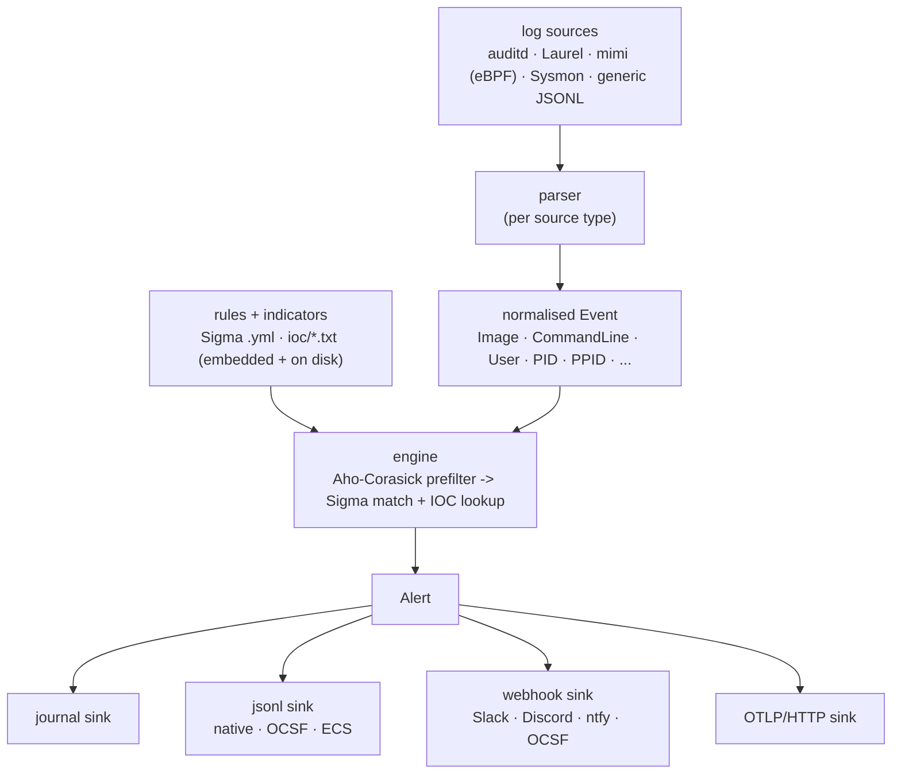

# banken

[](https://github.com/conor-sometimes/banken/actions/workflows/ci.yml)


番犬 - "watchdog". A small, host-wide EDR for Linux: it reads the machine's audit/eBPF stream,
matches it against Sigma rules and IOC lists, and hands your SIEM a standards finding. One static
Go binary, no agent runtime, no Python, no kernel module - a poor-man's SentinelOne you can
actually read.

**Proof, not a pitch:** banken catches a live reverse shell end-to-end in **under 300 ms** off its
[mimi](https://github.com/conor-sometimes/mimi) eBPF sensor (267 ms in the VM switch test; ~30 ms
on real hardware), and emits a standard **OCSF 1.3.0 Detection Finding** (`class_uid 2004`,
analytic `reverse_shell`) with the **ATT&CK technique attached**. It is the real binary on real
auditd/eBPF, gated by the test suite - boot it yourself:

```sh
nix run github:conor-sometimes/banken#demo        # auditd floor (universal; needs only KVM)
nix run github:conor-sometimes/banken#demo-mimi    # the eBPF switch: the sub-second catch
```

Each boots a NixOS VM, runs the repo's own benign
[`revshell.sh`](tests/emulations/revshell.sh) as an unprivileged user, and prints the OCSF finding,
the measured exec-to-alert latency, the finding delivered to a mock SIEM, an ordinary admin
workload raising **zero** alerts, and the static binary + sandbox score. The demos reuse the
end-to-end tests ([`tests/switch.nix`](tests/switch.nix), [`tests/vm.nix`](tests/vm.nix)), so they
cannot claim a detection the suite does not gate.

## Highlights

Every line is verified against the code; see [Standards](#standards-and-how-they-are-checked) for
how each is checked.

- **100% SigmaHQ Linux coverage.** All **210/210** rules of the SigmaHQ `rules/linux` set (release
  `r2026-07-01`) load and evaluate; banken agrees with pySigma, the reference engine, on **182/182**
  evaluations.
- **banken's own detections.** ~59 rules organised by ATT&CK tactic, including **11 account-scoped
  rules for autonomous AI agents** (`rules/agent/`) - a niche the SigmaHQ set does not cover.
- **Standards out, no glue.** Findings as **OCSF 1.3.0** Detection Findings (validated in CI by the
  OCSF project's own validator), **ECS 8.11.0**, or **OTLP/HTTP** log records - Security Lake,
  Splunk, Datadog, Elastic or any OCSF/ECS/OTLP backend ingests them with no per-product mapping.
- **Proven on real distros.** Green on **8 distros + NixOS** on their own kernels and auditd (Rocky
  9, AlmaLinux 10, Fedora 44, Amazon Linux 2023, Debian 13, Ubuntu 24.04, openSUSE Leap 16, Arch),
  with the mimi eBPF path (CO-RE) and Sysmon-for-Linux exercised on top.
- **Tiny and safe.** One static, CGO-free binary (**~7 MiB**, **~14 MiB** RAM), **no kernel module
  or driver** - a bug is a missed detection in userspace, never a kernel panic or a blue screen.
- **Rule count is free.** An Aho-Corasick prefilter makes match time independent of the rule count,
  fuzz-proven to only ever over-admit, never miss a detection.
- **Measured, not self-reported.** ATT&CK coverage is scored by a live Atomic Red Team range
  (24/115 techniques on merit, 2026-11-01), improving with a published rule roadmap.

Honest framing: banken is **pre-alpha** and **Linux + systemd only**. There is no prebuilt binary
yet (non-NixOS users build the one static binary), no response actions yet (alert only), and the
journald/syslog parsers are stubs. What is listed above is what the repo proves today.

## Sources and outputs

banken parses the logs itself: one parser per source, all behind one interface, each normalising to
the event the rules match. Pick sources with `-source type:path` (repeatable).

| Source | What | Status |
| --- | --- | --- |
| **auditd** | raw Linux audit log; multi-line SYSCALL/EXECVE/PATH records stitched into one event | implemented, live on 8 distros |
| **Laurel** | auditd rendered to JSON ([Laurel](https://github.com/threathunters-io/laurel)), one event per line | implemented |
| **mimi** | [mimi](https://github.com/conor-sometimes/mimi) eBPF sensor, a live OCSF exec stream followed continuously | implemented, exercised across the distro matrix |
| **Sysmon for Linux** | Microsoft `sysmonforlinux` XML; Windows field names, so Windows Sigma rules apply unchanged | parser + module wiring; live validation (Ubuntu) in progress |
| **generic JSONL** | one pre-normalised event per line, the universal adapter for any collector | implemented |
| journald, syslog / auth | systemd journal, RFC 3164/5424 auth logs | stub (emits nothing yet) |

Outputs are pluggable sinks, any combination: the system **journal** (high/critical + a login
summary), **jsonl** (one file per day, in banken native / OCSF 1.3.0 / ECS 8.11.0), **webhook**
(generic, Slack, Discord, ntfy, or OCSF), and **OTLP/HTTP** to an OpenTelemetry collector. Matched
alerts flow through one dispatch point, so response actions (kill, isolate) slot in later without a
redesign; for now, alert only.

## Install and enable

Linux with systemd only. NixOS is first-class (the module, package and end-to-end VM test live in
this repo); any other systemd distro installs the binary + unit by hand - see
[docs/deployment.md](docs/deployment.md) and the follow-along
[docs/install-and-onboarding.md](docs/install-and-onboarding.md).

### NixOS - with flakes

```nix
# flake.nix
inputs.banken.url = "github:conor-sometimes/banken";
# in your nixosConfiguration's modules:
modules = [ banken.nixosModules.default ];
```

### NixOS - without flakes

The repo works on a channels / legacy-Nix setup too. Pin a checkout (channel, `fetchTarball`, niv,
or a submodule) and import the module and package directly - no flake needed:

```nix
{ pkgs, ... }:
let
  # pin however you like: a channel, niv, or fetchTarball with a sha256
  banken = builtins.fetchTarball {
    url    = "https://github.com/conor-sometimes/banken/archive/<rev>.tar.gz";
    sha256 = "<sha256>";
  };
in {
  imports = [ (import "${banken}/module.nix") ];
  # the package alone, if you only want the binary:
  # environment.systemPackages = [ (pkgs.callPackage "${banken}/package.nix" { }) ];
}
```

### Enable it

Either path gives you the `services.banken` module. One line is the whole setup:

```nix
services.banken.enable = true;
```

That turns on auditd with the rules banken reads (every execve, plus watches on `/etc/shadow` and
`/etc/gshadow`), a hardened oneshot unit, and a timer that scans every two minutes, alerting high
and critical hits to the journal. Everything else is optional:

```nix
services.banken = {
  enable = true;
  interval = "30s";
  extraRules = [ ./my-rules ];                         # Sigma .yml and ioc/ lists, on top of the baseline
  alerts.jsonl = { enable = true; format = "ocsf"; };  # /var/log/banken, one OCSF finding per line
  alerts.webhook = { enable = true; urlFile = "/run/secrets/banken-webhook"; style = "slack"; };
};
```

Every setting is both a NixOS option and a CLI flag (the module writes the YAML the binary reads),
so nothing is reachable only one way. Run modes: one-shot (timer-driven auditd floor, the default),
`--watch` (continuous: scans the floor and follows a live sensor stream in one process), and
`--follow` (one sensor as a push stream). See [docs/deployment.md](docs/deployment.md).

## Rules

Portable [Sigma](https://github.com/SigmaHQ/sigma) YAML, organised so a rule's *home* says what it
is, plus plain IOC lists for bulk feeds:

    rules/
      credential-access/  persistence/  execution/  ...   # behavioural rules, by ATT&CK tactic
      agent/                                               # account-scoped rules for autonomous AI agents
      optional/                                            # opt-in policy rules, shipped but off by default
      ioc/*.txt                                            # bulk IOC lists (filenames, IPs, domains)

banken evaluates the field modifiers `contains` / `startswith` / `endswith` / `re` / `cidr` /
`all` / `base64` / `base64offset` / `exists`, plain-value equality, `field: null` absence tests,
`*`/`?` wildcards, keyword selections, and `and`/`or`/`not`/parens with `N of` / `all of`. A rule
it cannot evaluate (the Windows transforms such as `utf16le`/`windash`, `fieldref`, Sigma
correlation rules) is reported at load with the file and reason, never silently dropped. Optional
rules ship in the binary but off, with an **observe** mode that records without paging so you can
measure a rule's noise first. IOC lists match filename/path, IP and domain indicators (a hash or URL
matches as a substring); the baseline ships no lists of its own, they come from disk or from a
threat-intel feed (STIX 2.1 / MISP files, TAXII 2.1 collections, `intel:` in the config). Full
detail: [docs/writing-rules.md](docs/writing-rules.md).

## Standards, and how they are checked

"Validated" means an independent tool checks banken's output; "measured" means a public test suite
is run against it. `just conformance` runs the Sigma, pySigma and OCSF gates against pinned
versions, so a broken claim fails the run.

| Standard | What banken does | How it is checked |
| --- | --- | --- |
| [Sigma](https://sigmahq.io) | Compiles Sigma natively, its own rules and SigmaHQ's | Loads **210/210** SigmaHQ Linux rules (`r2026-07-01`, `tools/sigmacov`); agrees with pySigma on **182/182** evaluations (`conformance/`) |
| [OCSF](https://schema.ocsf.io) 1.3.0 | Alerts as Detection Findings (class 2004) | **Validated** in CI: every committed finding passes the OCSF project's own validator (`just ocsf-validate`) |
| [ECS](https://www.elastic.co/guide/en/ecs/current/index.html) 8.11.0 | Alerts as Elastic Common Schema documents | Encoder unit-tested (`internal/alert/ecs_test.go`) |
| [MITRE ATT&CK](https://attack.mitre.org) | Every rule tagged tactic + technique; exported as a Navigator layer | Tag mapping unit-tested; `tools/attack-layer`; scored by the ATT&CK range below |
| [OTLP](https://opentelemetry.io/docs/specs/otlp/) | Findings as OTLP/HTTP log records | Exporter unit-tested (`internal/alert/otlp_test.go`) |
| [Atomic Red Team](https://github.com/redcanaryco/atomic-red-team) | Live ATT&CK range: every Linux atomic of a pinned commit, run for real in a VM | **Measured**: 24/115 techniques detected on merit, 2026-11-01 ([scoring](attackrange/README.md)) |
| systemd | Hardened unit + timer | `systemd-analyze security`: exposure **2.1 "OK"** on every matrix distro |

The [live distro matrix](tests/distros/README.md) (`nix run .#distro-matrix`) boots each vendor's
own cloud image under KVM, installs banken as the docs say, runs benign malware look-alikes against
that distro's own kernel and auditd, and scores 15 objectives per distro - plus the mimi eBPF
objectives (M1-M5) and Sysmon-for-Linux objectives (S1-S5). All green as of 2026-10-31/11-01.
Planned, not yet implemented: YARA, a network source (Zeek/Suricata) for network IOCs, a NixOS
option for the threat-intel feeds (config-file only today), SBOM + SLSA provenance.

## Security model

banken runs as root and may one day pull rules from a remote repo, so the rule channel must never
become a way to run code as root. The guarantee is layered: **rules and logs are inert data** (no
eval path, no shell-out, no `${...}` expansion - the log4j lesson - RE2 regex only); banken is
**pure Go, no cgo/`unsafe`, no kernel module**, so EDR bug classes (buffer overflow, use-after-free,
kernel panic) are structurally impossible; and response actions are operator policy, never
rule-embedded. Trusted-path checks and signed remote bundles are planned. Full threat model:
[docs/security-model.md](docs/security-model.md).

## Performance

Matching does not scan every rule against every event: an Aho-Corasick prefilter makes match time
**independent of the rule count** (a fuzz target proves it agrees with checking every rule, so it is
a speed-up with no detection cost). Measured on a shared host: end-to-end detect latency p50 134 us
/ p99 699 us against the real rule tree; ~25,000 events/sec per core; ~7 MiB static binary, ~14 MiB
RAM, cold start to first finding p50 12 ms. Numbers, hardware and the staged breakdown:
[docs/performance.md](docs/performance.md).

## Testing

Heavily tested - a root daemon parsing untrusted log bytes has to be. Table tests for every parser,
rule compiler and matcher; "never-die" contracts (corrupt state recovers, panic guards, rule values
stay inert); a Go fuzz campaign reaching **~73.6M executions, zero crashes**; benign-malware
emulations run against real auditd in a NixOS VM test; and CI running race/vet/staticcheck/gosec/
govulncheck plus the OCSF-golden validation on every push. Detail:
[docs/testing.md](docs/testing.md). Contributors: [CONTRIBUTING.md](CONTRIBUTING.md).

## How it works

Logs in, alerts out - one pass, no state beyond a cursor:



A systemd timer drives the pass; `--watch` self-times instead. banken watches the *whole host* - a
contained AI agent, a cron job, a logged-in user: if it does something a rule flags, banken alerts.
Deeper: [docs/architecture.md](docs/architecture.md).

## Status and roadmap

**Pre-alpha, past the floor.** Working today: raw auditd and Laurel input, the generic JSONL
adapter, the mimi eBPF sensor as a live stream, the Sigma subset with SigmaHQ's full Linux set, IOC
lists, journal/jsonl/webhook/OTLP alerts in native/OCSF/ECS shapes, and the one-shot timer plus the
`--watch`/`--follow` daemon.

Roadmap, roughly in order:

- **In progress:** end-to-end Sysmon-for-Linux validation against Microsoft's real binary.
- **Sources:** the journald and syslog/auth parsers (stubs today); a network source (Zeek/Suricata).
- **Detection:** network IOCs; a NixOS option for the STIX/MISP/TAXII feeds (config-file only today).
- **Response:** actions (kill a process, revoke a key, isolate) through the existing dispatch point.
- **Ops:** a prebuilt binary and native packages; a baseline tuned over a week of real activity.

## Licence

MIT (see [LICENSE](LICENSE)). Rules are plain Sigma - copy them out with `git subtree split rules/`
if you want them without the binary.
