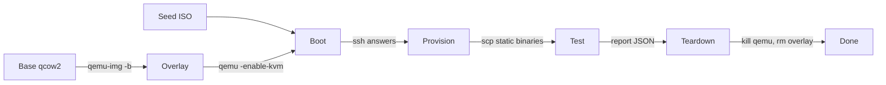
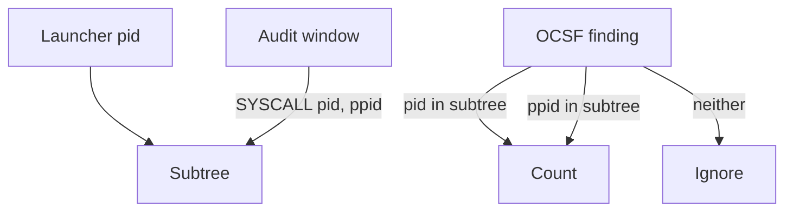

# Design: the distro matrix as its own repo

Status: **design, not implemented.** Nothing here exists in the tree yet. Written 2026-11-04
against commit `d9c8f16`. The thing it describes lives today in `tests/distros/`. The task is
Taskwarrior `32b8ddb1` (project banken).

Conor's brief: "Make it nice enough for anyone to use, but useful for us too."

## Contents

- [1. The capability](#1-the-capability)
- [2. Why it is bespoke](#2-why-it-is-bespoke)
- [3. What exists today](#3-what-exists-today)
- [4. The per-distro lifecycle](#4-the-per-distro-lifecycle)
  - [4.1 Spin up](#41-spin-up)
  - [4.2 Provision](#42-provision)
  - [4.3 Test](#43-test)
  - [4.4 Spin down](#44-spin-down)
- [5. Spin up all](#5-spin-up-all)
- [6. The module API](#6-the-module-api)
  - [6.1 Distros as a Nix attrset](#61-distros-as-a-nix-attrset)
  - [6.2 `lib.mkMatrix`](#62-libmkmatrix)
  - [6.3 Subjects](#63-subjects)
  - [6.4 Checks](#64-checks)
  - [6.5 Flake outputs](#65-flake-outputs)
  - [6.6 How the banken family consumes it](#66-how-the-banken-family-consumes-it)
  - [6.7 Integrate it into your workflow](#67-integrate-it-into-your-workflow)
  - [6.8 Worked examples: five big projects](#68-worked-examples-five-big-projects)
- [7. Migration from `tests/distros`](#7-migration-from-testsdistros)
- [8. Requirements: KVM, network, CI](#8-requirements-kvm-network-ci)
- [9. Roadmap](#9-roadmap)
- [10. Decisions made here](#10-decisions-made-here)
- [11. Open questions for Conor](#11-open-questions-for-conor)

## 1. The capability

One command boots N real Linux distros, runs your checks on each, and tears every VM down.

```sh
nix run .#matrix                  # every distro, every check
nix run .#distro-rocky-9          # one distro
nix run .#distro-rocky-9 -- -keep # one distro, keep the VM's work dir for a look
```

The distros are the vendors' own cloud images. Each boots on its own kernel, its own systemd,
its own auditd, its own SELinux or AppArmor. Nothing is emulated or containerised.

Two audiences use the same repo:

- **Anyone.** A stranger passes their own static binary and their own checks. They get spin-up,
  provisioning, test and teardown over the whole distro set. No Go. No QEMU flags. One command
  from their own repo or CI (section 6.7).
- **The banken family.** banken, mimi and hitomi each consume the repo as a flake input. Each passes
  its own static binary, its own units and its own check set. The result is the per-distro
  detection matrix the README badges come from.

The repo's name is proposed as `conor-sometimes/distro-matrix` (open question 1).

## 2. Why it is bespoke

Two standard tools do not fit. That is the irreducible reason this harness exists.

- **`runNixOSTest` boots only NixOS.** It builds the guest from a NixOS configuration. It cannot
  boot a Rocky kernel or a Debian systemd. banken's NixOS proof (`tests/vm.nix`) uses it. The
  other eight platforms cannot.
- **Containers share the host's audit stream.** The Linux audit subsystem is not namespaced. A
  container running auditd sees the host's events, or nothing. An EDR that reads auditd cannot be
  tested in a container.

So the harness boots real cloud images in QEMU under KVM. That is the only general route to "this
tool works on this distro as the vendor ships it".

## 3. What exists today

`tests/distros/` in banken is the working prototype. Its measured facts, status 2026-11-01:

- **8 vendor distros, live.** Rocky 9, AlmaLinux 10, Fedora 44, Amazon Linux 2023, Debian 13,
  Ubuntu 24.04, openSUSE Leap 16, Arch. NixOS is the ninth platform, proven by `tests/vm.nix`.
- **Every one of banken's own ~40 rules fires live on all 8** (commit `6162ac3`). Each malware
  look-alike fires exactly its expected rules. A normal day fires nothing.
- **mimi loads on all 8 vendor kernels** by CO-RE off each kernel's own BTF. banken detects off
  the mimi stream on every one.
- **Microsoft's real `sysmonforlinux`** installs and feeds banken on the 4 distros Microsoft
  serves. The other 4 are a recorded skip, never a red check.
- **Attribution is deterministic** since `6f26c58` (#57). Section 4.3 explains it.
- One distro is bounded at 30 minutes, boot to report. Three run in parallel. The whole matrix
  fits in a 4 hour timeout.

What it is made of:

| Piece | Lines | Role |
| --- | ---: | --- |
| `distros.json` | 154 | the distro list: image URL, checksum, package manager, command-to-package map |
| `default.nix` | 100 | `callPackage`: fetch images by checksum, build the runner and the payload |
| `matrix_test.go` | 331 | host side: one `go test` subtest per distro, boots QEMU, reads the report |
| `distrocheck/` | ~1900 | guest side: install, every objective, the attribution oracle, the report |
| `mimicheck.sh`, `sysmoncheck.sh` | 205 | the sensor stages, as shell printing `<id> PASS\|FAIL` lines |
| `report/` | 43 | the typed JSON wire format both sides share |
| `README.md` | 164 | the hand-maintained distro table and the objectives |

Three things are wrong with it as a general tool:

- **Two sources of truth.** `distros.json` says what boots. The README table says what passed.
  They drift by hand.
- **The checks are banken's, hard-coded in Go.** Objectives A1 to E1 live in `distrocheck/main.go`.
  A stranger cannot pass their own.
- **The payload carries a build system's worth of files.** The mimi glibc loader bundle, the whole
  source tree as a tar, and one test binary per package. That was forced by dynamic linking and
  by an in-guest test suite. Section 4.2 explains what replaces it.

## 4. The per-distro lifecycle

Every distro goes through the same four stages. The base image is never written.



### 4.1 Spin up

The pinned image sits read-only in the Nix store. `fetchurl` fetched it by the vendor's checksum.
A sha256 mismatch fails the build, so a moved or tampered image never boots.

The runner creates a copy-on-write overlay on it:

```sh
qemu-img create -q -f qcow2 -F qcow2 -b "$base" "$work/overlay.qcow2" "$size"
```

`$size` is the image's own virtual size or 20 GiB, whichever is larger. Too small and the guest
kernel rejects the disk (Amazon Linux describes 25 GiB). Too small and installs fill it (openSUSE
ships a few GiB). cloud-init grows the root partition to fit.

The seed is a NoCloud ISO (`xorriso`, volume label `cidata`). It holds three files:

- `meta-data`: instance id and hostname, both `matrix-<distro>`.
- `user-data`: one user named `matrix` with passwordless sudo and one SSH public key.
- `network-config`: absent; QEMU's user network hands out DHCP.

The SSH keypair is generated per run (`ssh-keygen -t ed25519`) into the work dir. It never
leaves the host and dies with the run.

QEMU boots the overlay with KVM, 2 vCPUs and 2 GiB by default, and SSH forwarded to a loopback
port the runner picked:

```sh
qemu-system-x86_64 -enable-kvm -cpu host -m 2048 -smp 2 \
  -display none -monitor none -no-reboot -pidfile "$work/qemu.pid" \
  -drive file="$work/overlay.qcow2",if=none,id=root,format=qcow2 \
  -device virtio-blk-pci,drive=root,bootindex=0 \
  -drive file="$work/seed.iso",media=cdrom,readonly=on \
  -netdev user,id=n0,hostfwd=tcp:127.0.0.1:"$port"-:22 -device virtio-net-pci,netdev=n0 \
  -serial file:"$work/serial.log"
```

The runner polls `ssh -p $port matrix@127.0.0.1 true` until it answers, bounded by the boot
timeout. Host key checking is off for this connection. The peer is a throwaway VM on loopback with
a key that exists only for this run, so there is nothing a host key would protect.

The serial log is kept for one purpose: when SSH never answers, its tail is the error message.

### 4.2 Provision

The runner copies the subjects in over `scp` and starts them. A subject is a static binary plus
the files it needs on the box. For banken that is:

- `banken`, static, to `/usr/bin/banken`
- `banken.service` and `banken.timer` to `/etc/systemd/system/`
- `/etc/audit/rules.d/banken.rules` and `/etc/banken/banken.yml`
- a `setup` script, run once as root: load the audit rules, drop `-a task,never`, `daemon-reload`

Then `systemctl enable --now` for whatever the subject lists.

**This is the key simplification the static-binary work unlocked.** banken has always been one
CGO-free static Go binary. mimi became a fully static musl binary in mimi `0e56e33` (#8),
proven by its `vm-musl` check. hitomi carries the same musl scaffolding. A static binary is
copy-and-run on any Linux of the same architecture. So provisioning is `scp` and a unit file.

What that replaces, item by item:

| Old payload item | Why it existed | Now |
| --- | --- | --- |
| `mimi-bundle/` (mimi, `ld.so`, `libc.so.6`, `libgcc_s.so.1`) | mimi was dynamic; the guest has no /nix | one static `mimi` |
| `mimicheck.sh` running mimi via `ld.so --library-path` | same | runs `mimi` directly |
| `src.tar` (the whole source tree) | the in-guest Go test suite reads fixtures from it | not shipped by the engine (open question 3) |
| `suite/*.test` (one test binary per package) | same | not shipped by the engine (open question 3) |
| `bootcmd` copying `distrocheck` off the ISO | SELinux refuses to exec a file labelled for an ISO | `scp` lands files with the directory's own label |
| the raw virtio report disk | the only channel out of a guest with no SSH | SSH stdout |

The engine refuses a dynamic subject at build time. The payload derivation runs `file` on every
subject binary and fails unless it reports `statically linked`. The error names the subject. A
stranger finds out before any VM boots.

Package installs stay. The guest still needs auditd, `runuser`, `tar` and whatever tools the
checks name. Section 6.1 shows how the distro attr maps each command to its package. The
install path is the package manager the vendor ships, with the proxy handling `tests/distros`
already has: apt, dnf, zypper and pacman each pointed at the host proxy when one is set, and
dnf and zypper pinned to the vendor's own host so an egress allow-list can name it.

### 4.3 Test

The runner copies `distrocheck` in beside the subjects. `distrocheck` is itself a static Go
binary. It is the in-guest oracle. The runner starts it over SSH:

```sh
ssh -p "$port" matrix@127.0.0.1 sudo distrocheck -root /opt/matrix
```

`/opt/matrix` holds the checks, the expected results and a `config.json` the runner wrote. The
report comes back as JSON on stdout. Section 10 says why the oracle stays in the guest.

The oracle runs each check in declared order. A `detect` check is the one that matters for an
EDR, and the one that makes the matrix trustworthy. Its contract:

1. Run the emulation under its own launcher process: `runuser -u alice -- bash -c '...'`.
   The launcher's pid is recorded.
2. Let the subject detect off the guest's own auditd or sensor stream. The oracle never feeds
   the subject anything.
3. Collect every OCSF finding the subject wrote since the check began.
4. Attribute each finding to this check, or not, by **process-subtree identity**.
5. The set of rules attributed must equal the check's `expect` list. A miss fails. An extra fails.

Attribution by identity is what replaced the racy scan-window diff. The old method blamed a
family for every alert that appeared in its wall-clock window. auditd flushes records
asynchronously and completes them out of order. One family's last exec bled into the next
family's window. Sleeps, settle loops and daemon masking only lowered the odds. They could not
remove them.

The identity method:



- The audit window is every audit log line appended since the check began.
- Each `SYSCALL` record carries `pid=` and `ppid=`. Together they are a pid-to-parent map.
- The subtree is the launcher plus every pid whose parent chain reaches the launcher.
- Each OCSF finding carries its evidence process's pid and its parent's pid
  (`evidences[0].process.pid`, `evidences[0].process.parent_process.pid`).
- A finding counts for the check if its pid is in the subtree. If not, its ppid is tried. That
  covers a short-lived exec whose own record is not yet in the window; its parent still is.
- A pid of 0 means "not recorded" and never matches.

Why it is deterministic:

- A process's parentage is fixed at fork. Async flush cannot change it.
- A cron job or fwupd runs under a different subtree. It is simply not attributed. No masking.
- A prior check's late exec is under the prior check's launcher. It cannot bleed in.
- The window only bounds how much log is read. The subtree decides.

`attribute.go` and `attribute_parse.go` are the whole of it: 167 lines. They parse `exe=` in both
of auditd's spellings (quoted and hex-encoded), anchor `pid=` so it never matches inside `ppid=`,
and walk the tree with an explicit stack. They move to the new repo unchanged.

On a miss the oracle says what the guest actually exec'd (every distinct `exe=` in the window) and
prints the raw record behind any unexpected rule. "fired [] expected [account_creation]; execs:
[bash]" means `useradd` never ran. "execs: [useradd]" points at the rule instead.

A `script` check is the escape hatch. The oracle runs a script as root and parses its
`<id> PASS|FAIL <detail>` lines. A `SKIP <reason>` line is recorded, not failed. That is what
`mimicheck.sh` and `sysmoncheck.sh` already are. Any tool with no OCSF output uses this kind.

The report is one JSON document per distro: platform facts (OS, kernel, systemd, LSM, SELinux
mode, audit rule count), then one `{id, pass, detail}` per check. The oracle writes a partial
report after every check. A guest that dies mid-run still tells the host how far it got.

### 4.4 Spin down

The runner sends `sudo systemctl poweroff` over SSH and waits a few seconds. Then it kills the
QEMU pid from the pidfile regardless. Then it removes the work dir: overlay, seed, key, serial
log, report. The base image in the store is untouched.

`-keep` skips the removal and prints the work dir. That is the only way a VM's disk survives a run.

## 5. Spin up all

`nix run .#matrix` boots every distro concurrently. Each has its own QEMU, its own overlay, its
own forwarded port, its own work dir under one run root:

```
$XDG_RUNTIME_DIR/distro-matrix/<run-id>/<distro>/
```

Concurrency is bounded by the host. The default parallelism is the smaller of:

- `nproc / 2` (two vCPUs per guest)
- `(RAM - 2 GiB) / 2.5 GiB` (2 GiB per guest plus QEMU's own overhead)

`-parallel N` overrides it. Today's prototype uses 3 on hokkaido.

Cleanup is guaranteed by two layers. Either alone is enough. Both exist because a Ctrl-C can land
anywhere.

- **The runner.** It catches SIGINT and SIGTERM. It cancels every guest's context. Each guest's
  context cancel kills its QEMU process group and removes its work dir. The runner exits non-zero.
- **The app wrapper.** The Nix app is a `writeShellApplication`. Its text sets
  `trap 'kill -- -$$ 2>/dev/null; rm -rf "$run_root"' EXIT INT TERM` before exec'ing the runner
  in its own process group. If the runner is SIGKILLed, the trap still runs when the shell gets
  EXIT. A stale run root from a hard power loss is one `rm -rf`.

QEMU runs with `-pidfile`. The runner never guesses a pid from `ps`.

One distro's failure never stops another. The matrix reports every distro, then exits non-zero
if any check failed. Output stays plain `go test`:

```
--- FAIL: TestMatrix/alma-10/revshell
```

## 6. The module API

### 6.1 Distros as a Nix attrset

`distros.json` and the README table become one attrset. It is the only source of truth. The
README table is generated from it (section 6.5).

```nix
# distros/default.nix
{
  rocky-9 = {
    title = "Rocky 9";
    image = {
      url = "https://dl.rockylinux.org/pub/rocky/9/images/x86_64/Rocky-9-GenericCloud-Base-9.8-20260525.0.x86_64.qcow2";
      sha256 = "92c206cc6f790c61583247eefe87890f8828420662c17cacf247cec78ab4eec8";
    };
    pm = "dnf";
    family = "rhel";
    packages = {
      auditd = "audit"; auditctl = "audit"; runuser = "util-linux"; pkill = "procps-ng";
      tar = "tar"; curl = "curl"; python3 = "python3"; nmap = "nmap"; tcpdump = "tcpdump";
    };
  };
  debian-13 = {
    title = "Debian 13";
    image = { url = "..."; sha512 = "..."; };
    pm = "apt";
    family = "debian";
    packages = { auditd = "auditd"; auditctl = "auditd"; pkill = "procps"; /* ... */ };
  };
  # alma-10, fedora-44, amazonlinux-2023, ubuntu-24.04, opensuse-leap-16, arch
}
```

Field by field:

| Field | Required | Meaning |
| --- | --- | --- |
| `title` | yes | the human name, for the generated table |
| `image.url` + `image.sha256` or `image.sha512` | yes | a versioned vendor URL, never a `latest` link |
| `pm` | yes | `dnf`, `apt`, `zypper` or `pacman`; selects the install and proxy recipe |
| `family` | no | `rhel`, `debian`, `suse`, `arch`; a check's `when` can test it |
| `packages` | yes | generic command name to the package that provides it on this distro |
| `boot` | no | `{ mem, cpus, disk }` overrides for an image with unusual needs |

**Add a distro = add one attr.** The engine picks it up, fetches it, boots it, runs every check.
There is no code to touch and no table to edit. The generated README gets a new row.

A `packages` map is per-distro knowledge, so it lives with the distro. A consumer's subject or
check says `tools = [ "nmap" ]`. The engine resolves `nmap` through the distro's map. A tool no
distro attr maps is an eval-time error that names the attr to extend.

NixOS can join the set as a ninth attr whose `image` is a derivation instead of a URL: a
cloud-init-enabled qcow2 from `config.system.build.images`. The engine accepts either shape.
That is roadmap work, not this design (open question 6).

### 6.2 `lib.mkMatrix`

One function builds everything:

```nix
lib.mkMatrix {
  pkgs = nixpkgs.legacyPackages.x86_64-linux;
  distros = distro-matrix.distros;          # or lib.filterAttrs over it
  subjects = { ... };                       # section 6.3
  checks = { ... };                         # section 6.4
}
```

It returns:

```nix
{
  apps = {
    matrix = <app>;                         # every distro
    "distro-rocky-9" = <app>;               # one per distro attr
    # ...
  };
  checks = {
    "distro-rocky-9" = <derivation>;        # one per distro attr; section 8 says where it runs
    # ...
  };
  readme = <derivation>;                    # the generated distro table, Markdown
}
```

A consumer splices these into its own flake with `//`.

Inside, `mkMatrix` does what `default.nix` does today, with the shape fixed:

- `fetchurl` each image by its checksum
- build the runner and `distrocheck` (both Go, both `CGO_ENABLED=0`)
- assemble the payload: subjects, checks, `config.json` per distro
- assert every subject binary is static
- wrap the runner in a `writeShellApplication` with `qemu`, `xorriso` and `openssh` on PATH
  and the cleanup trap set

### 6.3 Subjects

A subject is the thing under test. It is an attrset of files and one setup step:

```nix
subjects.banken = {
  binary = lib.getExe banken;                       # must be static
  installPath = "/usr/bin/banken";                  # default /usr/local/bin/<name>
  units = [ ../packaging/systemd/banken.service ../packaging/systemd/banken.timer ];
  files = {
    "/etc/audit/rules.d/banken.rules" = ./banken.rules;
    "/etc/banken/banken.yml" = ./banken.yml;
  };
  tools = [ "auditd" "auditctl" "runuser" ];        # resolved through distros.<name>.packages
  setup = ./setup.sh;                               # root, once, after files land
  enable = [ ];                                     # units to `systemctl enable --now`
};
```

Several subjects can be passed. mimi's matrix passes both `mimi` and `banken`, because the
check is "banken detects off mimi's stream". They are provisioned in attr order. `subjects` may
also be empty: then the checks test the distro itself.

### 6.4 Checks

A check is one thing the matrix proves on every distro. Two kinds:

```nix
checks = {
  revshell = {
    kind = "detect";
    run = ../emulations/revshell.sh;                # runs under its own launcher
    as = "user";                                    # "user" (alice) or "root"
    expect = [ "reverse_shell" ];                   # the exact rule set, by subtree identity
    tools = [ ];
  };
  portscan = {
    kind = "detect";
    run = ../emulations/portscan.sh;
    expect = [ "port_scan" ];
    tools = [ "nmap" ];
    optional = true;                                # tool missing on a distro = skip, not fail
  };
  benign-day = {
    kind = "detect";
    run = ./benign.sh;
    expect = [ ];                                   # a normal day fires nothing
  };
  sysmon = {
    kind = "script";
    run = ./sysmoncheck.sh;
    ids = [ "S1" "S2" "S3" "S4" "S5" ];
    when = d: d.pm == "apt" || d.family == "rhel";  # Microsoft serves these
    order = 90;
  };
};
```

Field by field:

| Field | Kinds | Meaning |
| --- | --- | --- |
| `kind` | both | `detect` (OCSF oracle, identity attribution) or `script` (PASS/FAIL lines) |
| `run` | both | the script; `detect` runs it under a launcher, `script` runs it as root |
| `as` | detect | which user the launcher runs as; default `user` |
| `expect` | detect | the sorted rule set that must fire, exactly; `[ ]` means none |
| `ids` | script | the check ids the script must report; a missing id fails |
| `when` | both | a predicate on the distro attr; false means not an objective on that distro |
| `tools` | both | commands the check needs; resolved like a subject's |
| `optional` | both | a missing tool skips the check instead of failing the distro |
| `order` | both | run order, lowest first; default 50; ties by name |

Two built-ins need no script. They take only a unit name and suit any subject that ships one:

- `{ kind = "sandbox"; unit = "banken.service"; }`: `systemd-analyze security` on the guest's own
  systemd must rate the unit SAFE or OK.
- `{ kind = "lsm"; match = "banken"; }`: the distro's SELinux or AppArmor, as shipped, logged no
  denial mentioning the subject.

The `expect` list for banken's `detect` checks is derived from the fixtures, exactly as
`matrix_test.go` does today: `tests/fixtures/<family>.expect-<rule>.json`. A small Nix function
in banken's tree reads that directory into the `checks` attrset. The fixtures stay the one place
a rule's expected firing is declared.

### 6.5 Flake outputs

The repo's own `flake.nix` exposes:

| Output | What |
| --- | --- |
| `lib.mkMatrix` | section 6.2 |
| `distros` | the attrset of section 6.1 |
| `apps.x86_64-linux.default` | the CLI of section 6.7: `--binary`, `--unit`, `--check`, `--distro`, no Nix file needed |
| `apps.x86_64-linux.matrix` | the smoke matrix: a tiny static `hello` subject and one `script` check per distro |
| `apps.x86_64-linux."distro-<name>"` | the same, one distro |
| `apps.x86_64-linux."example-<project>"` | one of the five worked examples of section 6.8, every distro |
| `checks.x86_64-linux.readme` | fails if the committed README table differs from the generated one |
| `packages.x86_64-linux.readme` | writes the generated table, for `nix run .#readme > README.md` |

Flake apps are a flat attrset per system. `nix run .#distro.rocky-9` would be parsed as a path
into an attrset named `distro`. So the spelling is `distro-<name>`, one flat attr per distro
(decision 2). The brief's `apps.distro.<name>` reads the same way; only the separator changes.

A consumer's flake gets the same shape by splicing `mkMatrix`'s result:

```nix
apps.x86_64-linux = matrix.apps // { demo = ...; };
checks.x86_64-linux = matrix.checks // { vm = ...; };
```

The README table is generated from the attrset and from the last report. The attrset gives the
rows. A committed `results.json`, written by the runner with `-record`, gives the ticks. The
`readme` check keeps the committed table honest: a new distro attr with no regenerated table fails
CI.

### 6.6 How the banken family consumes it

Each repo adds one flake input and one small file.

**banken** (`tests/distros/matrix.nix`, ~60 lines):

```nix
inputs.distro-matrix.url = "github:conor-sometimes/distro-matrix";

matrix = distro-matrix.lib.mkMatrix {
  inherit pkgs;
  distros = distro-matrix.distros;
  subjects.banken = { binary = lib.getExe bankenPkg; units = [ ... ]; files = { ... }; setup = ./setup.sh; };
  checks = (import ./checks.nix { inherit lib; })   # detect checks from tests/fixtures
    // { sandbox = { kind = "sandbox"; unit = "banken.service"; };
         lsm = { kind = "lsm"; match = "banken"; };
         zero-config = { kind = "script"; run = ./zeroconfig.sh; ids = [ "A2" ]; order = 10; };
         timer = { kind = "script"; run = ./timer.sh; ids = [ "A3" ]; order = 20; };
         clean-logs = { kind = "script"; run = ./cleanlogs.sh; ids = [ "A4" ]; order = 95; };
         sysmon = { kind = "script"; run = ./sysmoncheck.sh; ids = [ "S1" "S2" "S3" "S4" "S5" ];
                    when = d: d.pm == "apt" || d.family == "rhel"; order = 90; }; };
};
```

`apps.x86_64-linux.distro-matrix` becomes `apps.x86_64-linux.matrix`. The `distro-matrix-mimi`
variant goes away from banken (see mimi below).

**mimi** passes two subjects and one check. Its matrix proves "the probe loads on this vendor
kernel and banken detects off the stream":

```nix
subjects = {
  mimi = { binary = "${mimi}/bin/mimi"; units = [ ./packaging/mimi.service ]; enable = [ "mimi.service" ]; };
  banken = { binary = lib.getExe banken.packages.x86_64-linux.banken; files = { "/etc/banken/mimi.yml" = ./tests/banken-mimi.yml; }; };
};
checks.mimi = { kind = "script"; run = ./tests/mimicheck.sh; ids = [ "M1" "M2" "M3" "M4" "M5" ]; };
```

`mimicheck.sh` shrinks: M1 is a file copy, and `run_mimi` is `mimi --sink ...` with no loader.
mimi already has banken as a test-only input direction in reverse (banken's flake pulls mimi for
the switch tests). The matrix moves the sensor-on-vendor-kernel proof to the sensor's own repo,
where it belongs. banken's own matrix stays the auditd floor.

**hitomi** does the same with its YARA sensor once its static build ships: subject `hitomi`, a
`script` check that drops an EICAR-shaped file and expects the finding. hitomi has no public repo
yet (open question 5).

### 6.7 Integrate it into your workflow

Conor's second brief: anyone can push their testing at it, from their own workflow. So the
contract a tester must meet is three things, and the ways in are three, smallest first.

What the tester brings:

- a static binary, or none (a check can test the distro itself, such as "does it ship BTF")
- one or more scripts that print `<id> PASS|FAIL <detail>` lines, in any language
- optionally, OCSF findings with process evidence, to use `detect` checks and the identity oracle

What the tester gets back:

- one report per distro, `go test` style on the terminal, non-zero exit on any failure
- `--json <file>` for the same report as data, for their own dashboard or badge
- `--keep` to open a failing VM and look

**Way 1: one command, no Nix file.** The repo's default app is a CLI. Its flags map one to one
to the subject and check fields of sections 6.3 and 6.4:

```sh
nix run github:conor-sometimes/distro-matrix -- \
  --binary ./foo --unit ./foo.service --enable foo.service \
  --check ./smoke.sh \
  --distro ubuntu-24.04 --distro rocky-9
```

No `--distro` means every distro. The files come from the working directory, not the store, so
this path is impure. The static-binary assertion runs at start instead of at build. Everything
else is the same engine. This is the path for "I have a binary, does it run on Rocky".

**Way 2: a flake input.** For a repo that wants the matrix inside its own `nix run` and
`nix flake check`. A stranger with a static binary `foo` and a unit writes:

```nix
distro-matrix.lib.mkMatrix {
  inherit pkgs;
  distros = distro-matrix.distros;
  subjects.foo = { binary = "${foo}/bin/foo"; units = [ ./foo.service ]; enable = [ "foo.service" ]; };
  checks.smoke = { kind = "script"; run = ./smoke.sh; ids = [ "S1" "S2" ]; };
}
```

`smoke.sh` prints `S1 PASS unit active` and `S2 PASS answered on :8080`, or FAIL. They get the
same spin-up, provisioning, run and teardown over eight distros. They never see QEMU, cloud-init,
`xorriso`, a port or a key. This is section 6.6's shape; banken is just one such consumer.

**Way 3: a CI step.** The same command in a workflow, on a KVM-capable runner:

```yaml
- name: KVM for the runner user
  run: |
    echo 'KERNEL=="kvm", GROUP="kvm", MODE="0666", OPTIONS+="static_node=kvm"' \
      | sudo tee /etc/udev/rules.d/99-kvm.rules
    sudo udevadm control --reload-rules && sudo udevadm trigger --name-match=kvm
- name: Smoke on Ubuntu 24.04
  run: nix run github:conor-sometimes/distro-matrix -- \
         --binary ./out/foo --unit ./foo.service --check ./ci/smoke.sh --distro ubuntu-24.04
```

One distro fits a standard hosted runner. A nightly job can run the whole set on a bigger one.

Pushing tests at the matrix never means changing the matrix. The tester's binary, units and
scripts stay in the tester's repo. The matrix repo takes two kinds of contribution: a new distro
attr, by PR, proven by the smoke matrix booting it; and a new worked example (section 6.8).
Nothing in the engine knows the word banken.

### 6.8 Worked examples: five big projects

Conor's third brief: the README shows real projects on the matrix, each as a small Nix module.
A reader finds the project closest to theirs and copies it. Each example is one directory:

```
examples/caddy/
  default.nix      # the mkMatrix call, ~15 lines
  caddy.service    # the unit, upstream's where it ships one, with the binary path fixed
  check.sh         # prints <id> PASS|FAIL lines
```

Each is wired as `apps.x86_64-linux."example-<project>"`, so `nix run .#example-caddy` runs it.
The README links the five directories and shows one in full.

The binary in every example is **the project's own release**, fetched by hash. Not the nixpkgs
build. A nixpkgs Go or Rust package links against the store's glibc and carries a store path as
its interpreter. It cannot copy-and-run on Rocky. The upstream static release can. That is also
the honest test: the bytes the project ships, on the distro the vendor ships.

A helper keeps that to one line:

```nix
lib.fetchRelease { url = "https://github.com/caddyserver/caddy/releases/download/v2.10.0/caddy_2.10.0_linux_amd64.tar.gz"; sha256 = "..."; bin = "caddy"; }
```

It unpacks the archive and returns the path of `bin`. The static assertion of section 4.2 still
runs on it.

The five, picked so each asks a question only a real distro can answer:

| Project | Kind | Release is static | The check | Why it is a distro question |
| --- | --- | --- | --- | --- |
| Caddy | web server | Go, `CGO_ENABLED=0` | `curl -fs localhost` returns `ok` | binding :80 as a service user; `AmbientCapabilities` under each distro's systemd |
| node_exporter | metrics agent | Go, `CGO_ENABLED=0` | `/metrics` has `node_cpu_seconds_total` and `node_systemd_unit_state` | collectors read `/proc`, `/sys` and D-Bus; the systemd collector needs each distro's bus policy |
| Vector | log pipeline | Rust, `x86_64-unknown-linux-musl` | a `journald` source reaches a file sink within 10 s | it shells out to each distro's own `journalctl`; journald layouts differ |
| etcd | key-value store | Go, `CGO_ENABLED=0` | `etcdctl put k v && etcdctl get k` | data dir under `StateDirectory`, fsync on each distro's default filesystem (xfs, ext4, btrfs) |
| MinIO | object store | Go, `CGO_ENABLED=0` | `curl -fs :9000/minio/health/live` | the same, plus a `User=` with no login shell on every distro |

The Caddy example in full, as the README shows it:

```nix
# examples/caddy/default.nix
{ pkgs, lib, distros }:
lib.mkMatrix {
  inherit pkgs distros;
  subjects.caddy = {
    binary = lib.fetchRelease {
      url = "https://github.com/caddyserver/caddy/releases/download/v2.10.0/caddy_2.10.0_linux_amd64.tar.gz";
      sha256 = "...";
      bin = "caddy";
    };
    units = [ ./caddy.service ];
    files = { "/etc/caddy/Caddyfile" = ./Caddyfile; };   # `:80 { respond "ok" }`
    enable = [ "caddy.service" ];
    tools = [ "curl" ];
  };
  checks.serves = { kind = "script"; run = ./check.sh; ids = [ "C1" "C2" ]; };
}
```

```sh
# examples/caddy/check.sh
systemctl is-active --quiet caddy && echo "C1 PASS caddy active" || echo "C1 FAIL $(systemctl status caddy --no-pager | tail -3)"
out=$(curl -fs --max-time 5 http://127.0.0.1/) && [ "$out" = "ok" ] && echo "C2 PASS served ok" || echo "C2 FAIL got: $out"
```

That is the whole example. The README's claim for each is one row of the generated table: five
projects, eight distros, forty cells, every one a real boot.

The examples are also the matrix's own regression test. The nightly on hokkaido runs one example
on one distro. A change to the engine that breaks provisioning fails there before it reaches
banken.

## 7. Migration from `tests/distros`

What moves to the new repo, and what it becomes:

| Today in banken | In `distro-matrix` | Change |
| --- | --- | --- |
| `distros.json` | `distros/default.nix` | JSON to attrset; `title` and `family` added |
| `default.nix` | `lib/mkMatrix.nix` | `banken` and `mimiBundle` args become `subjects` and `checks` |
| `matrix_test.go` | `cmd/matrix/` | seed-ISO-and-report-disk transport becomes SSH; cleanup trap; parallel bound |
| `distrocheck/attribute.go`, `attribute_parse.go` + tests | `internal/oracle/` | unchanged |
| `distrocheck/parse.go` + tests | `internal/oracle/` | unchanged (OCSF rule, severity, command line readers) |
| `distrocheck/main.go` install, proxy, package manager code | `cmd/distrocheck/` | kept; banken objectives removed |
| `distrocheck/main.go` objectives A2, A3, A4, E1 | banken `tests/distros/*.sh` | Go to `script` checks |
| `distrocheck/main.go` objectives D1, D2 | engine built-ins `sandbox`, `lsm` | generic by unit name |
| `distrocheck/main.go` B1, B2, C1, C2 | engine `detect` kind | B2 gains identity attribution |
| `report/` | `internal/report/` | `Config` gains the checks list; `Disk` constants go |
| `mimicheck.sh` | mimi `tests/mimicheck.sh` | loses the `ld.so` lines |
| `sysmoncheck.sh` | banken `tests/distros/sysmoncheck.sh` | unchanged; it tests banken's sysmon source |
| README distro table | generated | `nix run .#readme` |

What banken keeps:

- `tests/emulations/` and `tests/fixtures/`: the checks' sources. The matrix reads them; it
  does not own them.
- `packaging/systemd/`: the units, which are the subject.
- `tests/vm.nix` and the other `runNixOSTest` checks: NixOS stays proven there until the NixOS
  attr lands.
- `tests/distros/matrix.nix`, `checks.nix`, `setup.sh` and the `script` checks: ~200 lines in all.

The flake input wires in as section 6.6 shows. banken's `flake.lock` pins the matrix repo. A
distro bump is a pin bump. banken's CI `readme` check fails if the pin adds a distro the
committed table lacks.

The order of work, each step proven before the next:

1. Create the repo with the engine, the attrset, the README generator and the smoke subject.
   PASS line: `nix run .#matrix` boots all 8 and the `hello` check passes on each.
2. banken consumes it behind the input. Parity run: the same 8 distros, the same B1 verdicts
   as `6f26c58`. PASS line: every check that passed before passes after, and nothing new fails.
3. Delete `tests/distros/` in banken except `matrix.nix` and the check scripts. Regenerate the
   README table.
4. mimi consumes it with the two-subject matrix. PASS line: M1 to M5 on all 8.
5. hitomi, when its static build and repo are public.

Step 2 is the gate. If the SSH transport or the script-check port changes a verdict, the change
is a bug in the port, not a new fact about a distro.

## 8. Requirements: KVM, network, CI

- **KVM.** `/dev/kvm` must be readable by the runner. Without it the engine refuses to start with
  a one-line reason. No TCG fallback: eight guests under emulation would take a day.
- **Network.** Guests install packages from their vendors' repos. The host needs egress, or a
  proxy named in `http_proxy`/`https_proxy`. Behind an egress allow-list the engine pins dnf and
  zypper to the vendors' own hosts, as today. The pinned hostnames are listed in the repo README.
- **Disk.** The eight images are a few GiB in the store, fetched once. Overlays need up to 20 GiB each while a run lives.
- **RAM and CPU.** 2 GiB and 2 vCPUs per concurrent guest. Section 5 bounds concurrency by host.
- **`nix flake check` and the `checks.` entries.** The Nix build sandbox has no network, so a
  check that installs packages cannot run in it. The `checks."distro-<name>"` derivations set
  `__noChroot = true` and `requiredSystemFeatures = [ "kvm" ]`. They build only on a builder with
  `sandbox = relaxed` and the `kvm` feature. hokkaido can be that builder. Anywhere else, the
  derivation is refused with Nix's own message. For gating a single distro in GitHub CI, run the
  app instead: `nix run .#distro-ubuntu-24.04` as a workflow step on a KVM-capable runner.
- **GitHub-hosted runners.** Linux hosted runners expose `/dev/kvm`. A udev rule step makes it
  group-readable. One distro at 2 GiB fits a standard runner. The full matrix does not; it runs on
  hokkaido via `agent-job`, as today.

## 9. Roadmap

| Item | Status | Note |
| --- | :---: | --- |
| 8 vendor distros live under KVM, one command | ✅ | `tests/distros`, `6162ac3` |
| Every own rule fires live on all 8 | ✅ | `6162ac3` |
| Deterministic attribution by process-subtree identity | ✅ | `6f26c58` (#57) |
| mimi CO-RE load on all 8 vendor kernels | ✅ | Test B, M1 to M5 |
| Microsoft's real Sysmon on the 4 served distros | ✅ | Test S, S1 to S5 |
| banken static, CGO-free | ✅ | `package.nix` |
| mimi static, musl | ✅ | mimi `0e56e33` (#8), `vm-musl` check |
| hitomi static, musl | 🚧 | scaffolding referenced by mimi #8; repo not public |
| This design | 🚧 | this document |
| Repo `distro-matrix` with engine, attrset, README generator, smoke subject | ❌ | step 1 |
| SSH transport replacing seed-ISO bootcmd and the report disk | ❌ | section 4 |
| Static-subject assertion at build time | ❌ | section 4.2 |
| Cleanup trap, two layers; parallel bound by host | ❌ | section 5 |
| `detect` and `script` check kinds; `sandbox` and `lsm` built-ins | ❌ | section 6.4 |
| CLI path: `--binary`, `--check`, `--distro`, `--json`, no Nix authoring | ❌ | section 6.7, way 1 |
| CI recipe in the repo README (KVM udev step, one-distro gate) | ❌ | section 6.7, way 3 |
| `lib.fetchRelease` helper (upstream static release by hash) | ❌ | section 6.8 |
| Five worked examples: Caddy, node_exporter, Vector, etcd, MinIO | ❌ | section 6.8; the generated table gets five rows |
| Nightly on hokkaido runs one example on one distro | ❌ | section 6.8; the engine's own regression |
| banken consumes the input, parity run passes | ❌ | step 2, the gate |
| banken `tests/distros` reduced to `matrix.nix` + check scripts | ❌ | step 3 |
| mimi consumes it, two-subject matrix | ❌ | step 4 |
| hitomi consumes it | ❌ | step 5 |
| NixOS as a ninth attr (image as a derivation) | ❌ | open question 6 |
| aarch64 distros (Amazon Linux, Ubuntu ship them) | ❌ | needs an aarch64 KVM host |
| Recorded results feed the generated README ticks | ❌ | `-record`, section 6.5 |

## 10. Decisions made here

These were open in the brief. Each is a choice, and each can be reversed.

1. **The oracle stays in the guest.** `distrocheck` is copied in and run over SSH. The alternative
   was a host-side oracle reading the audit log and the alert sink over `ssh cat`. The guest-side
   oracle reads local files, knows the launcher pid directly, and needs one SSH round trip per
   distro instead of one per check. A stranger's `script` checks run the same way. SSH replaces
   only the transport: the seed ISO's `bootcmd`, the raw report disk and the serial-console
   channel go. The serial log stays for boot failures.
2. **App names are `distro-<name>`, flat.** Flake apps cannot nest. See section 6.5.
3. **Check kinds are exactly two, plus two built-ins.** `detect` and `script` cover every
   objective banken has today. `sandbox` and `lsm` are built in because they are a function of
   a unit name alone, so any subject with a unit gets them free. Everything else banken-specific
   (zero-config, timer, clean logs) becomes a `script` check in banken's tree. The engine never
   names banken.
4. **Daemon masking goes.** `distrocheck` masks fwupd and cron before detection. That was
   window-diff hygiene. Identity attribution makes it unnecessary, and B2 (benign day) gains a
   launcher of its own so a cron job cannot fail it either.
5. **The `expect` lists stay in banken's fixtures.** `checks.nix` derives them. The matrix reads
   the fixtures the same way `tests/vm.nix` does. One declaration per rule, as now.
6. **`checks.` entries exist but need a relaxed sandbox.** Section 8. CI gates a single distro by
   app. This is honest about what `nix flake check` can and cannot do with a networked guest.

## 11. Open questions for Conor

1. **Repo name.** `distro-matrix` is proposed. `vendor-matrix` and `distro-harness` were
   considered.
2. **App spelling.** `distro-<name>` (decision 2), or keep the hyphen out and accept
   `nix run .#"distro.rocky-9"` with quotes.
3. **E1, the in-guest Go test suite.** It needs the source tree and a test binary per package on
   every guest. Now that the binary is static, what E1 proves beyond the unit tests on NixOS is
   "the fixtures' `/proc` and path assumptions hold on this distro". Keep it as a banken `script`
   check that ships those files as `files`, or retire it from the matrix?
4. **Objective ids.** Keep A1 to S5 as the check ids in the report, or let the check attr name
   (`revshell`, `sandbox`, `sysmon`) be the id? The attr name reads better in `go test` output.
   The letter codes match the README prose.
5. **hitomi.** Its repo is not public. Step 5 waits on that, not on this design.
6. **NixOS in the attrset.** Keep NixOS proven by `tests/vm.nix` only, or build a cloud-init
   qcow2 and make it the ninth attr so the one table covers all nine? The second is more honest
   for the README. It is also a day of image work.
7. **SSH user.** A `matrix` user with passwordless sudo, as designed, or `disable_root: false` and
   SSH as root? Several images refuse root SSH by policy. The sudo user works on all eight.
8. **The five examples.** Caddy, node_exporter, Vector, etcd and MinIO are proposed (section 6.8).
   Each ships a static release and a daemon. Swap any for a project you would rather be seen
   next to. Candidates considered and dropped: osquery, Teleport and CrowdSec (whether their
   release binaries are fully static was not verified), Falco and Tetragon (kernel modules or
   eBPF, a different harness question).
